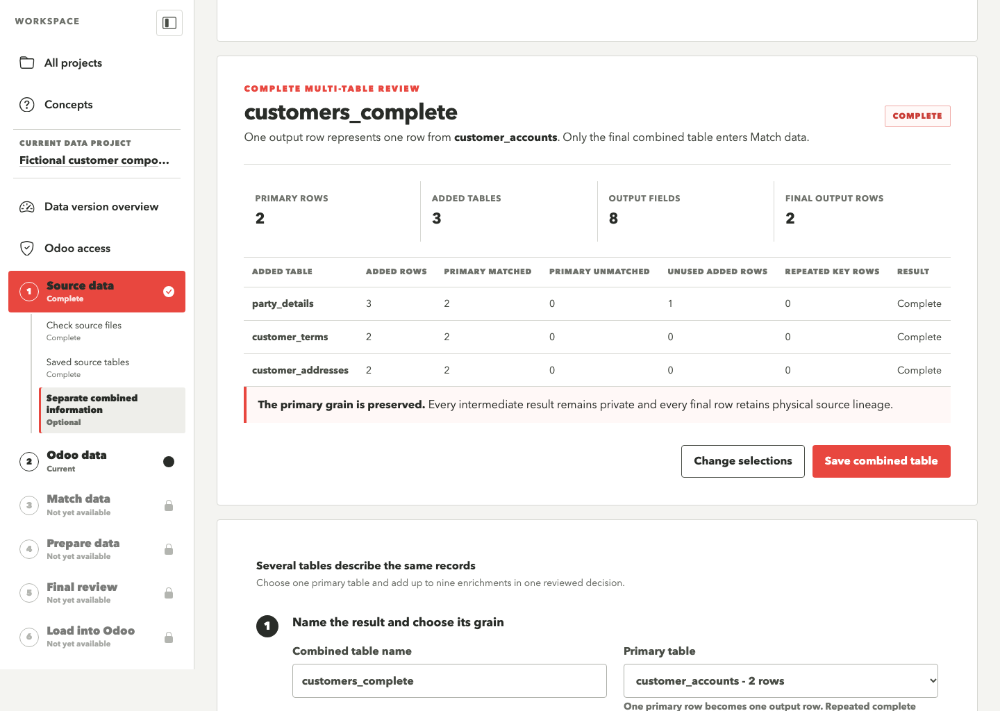
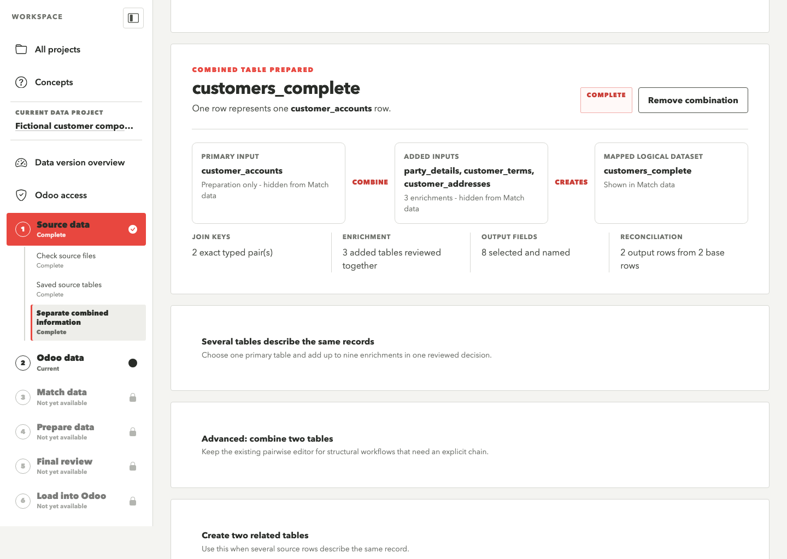
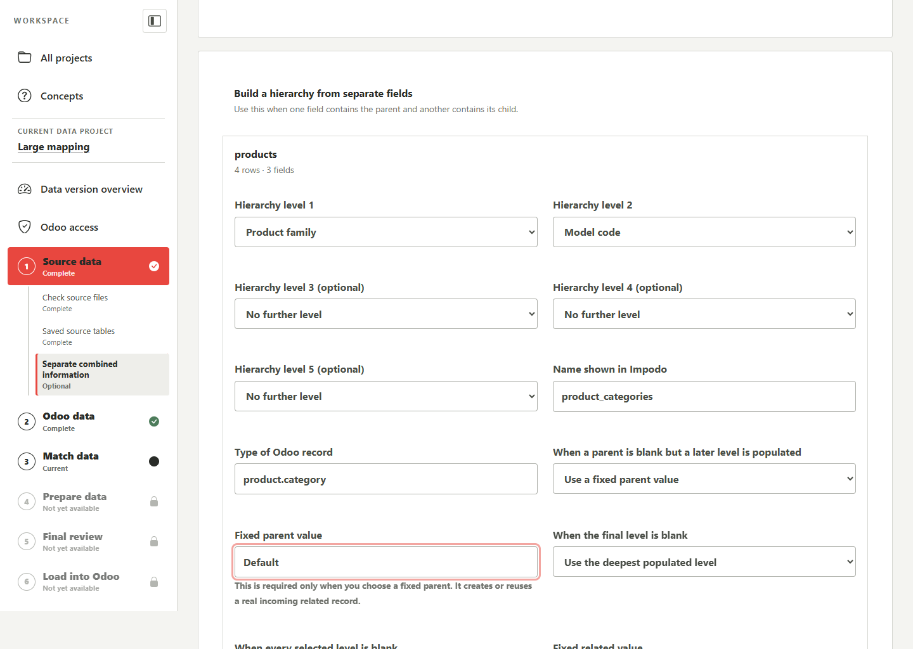
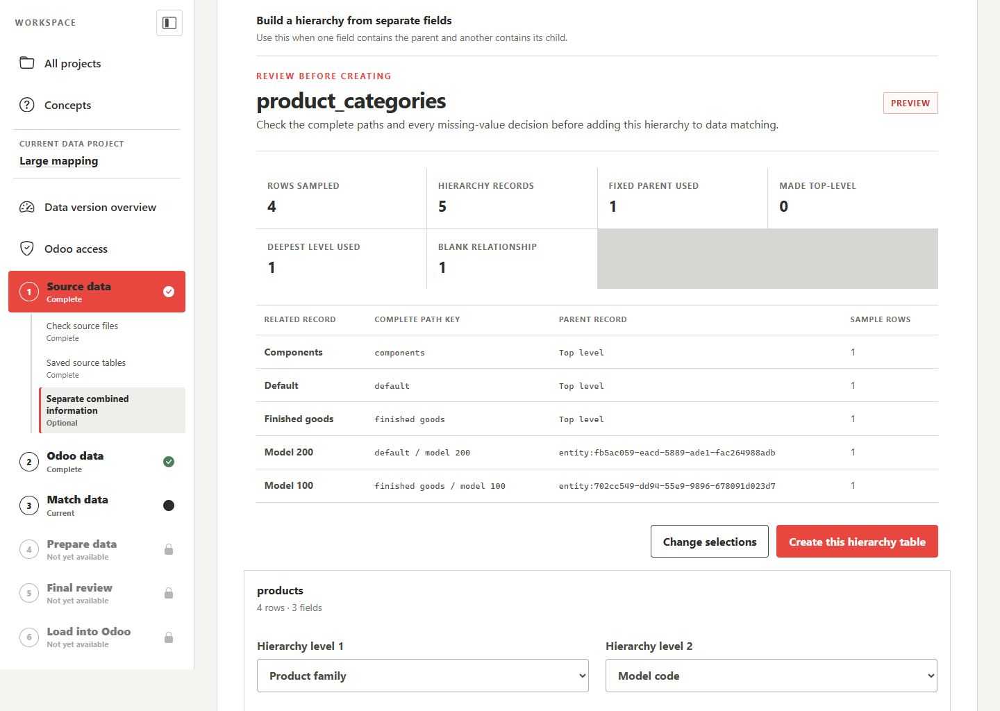
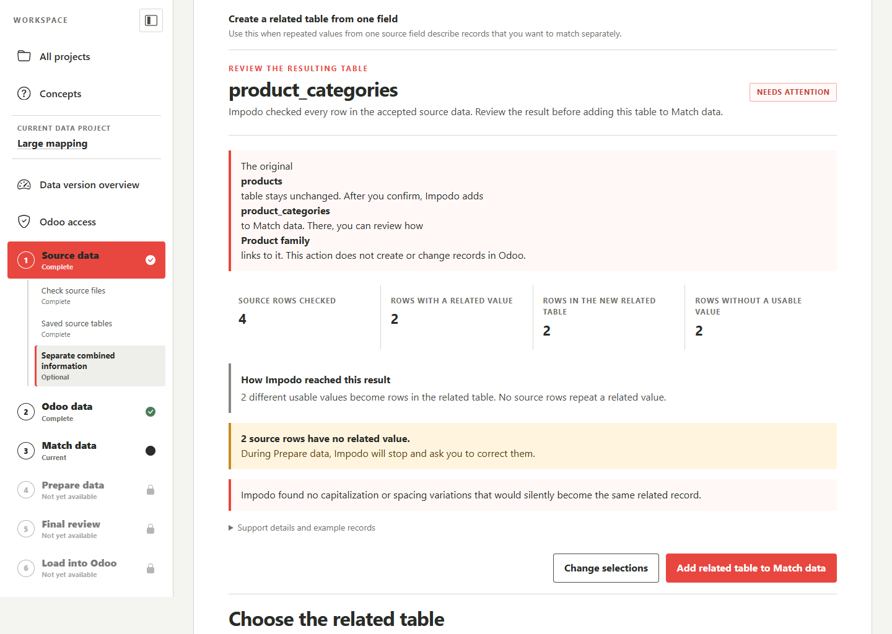
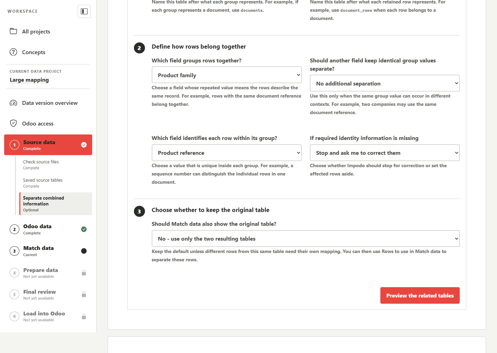

# Prepare related and combined tables

## Purpose

Use **Separate combined information** when a denormalized source file contains
information that should become more than one Odoo record type. Impodo saves
the rule and keeps the confirmed source unchanged.

The browser supports five shapes:

1. **Several tables describe the same records.** One primary table and up to
   nine partial source views become one logical dataset in one review.
2. **Advanced: combine two tables.** Two partial views become one logical
   dataset when an explicit pairwise structural step is needed.
3. **One field contains reusable values.** Repeated values become one related
   table, while the original rows remain available for mapping.
4. **Several fields form a hierarchy.** Two to five ordered source fields
   become one related hierarchy and one relationship value on the original
   rows.
5. **Several rows describe the same record.** Impodo creates one table with one
   row per group and another table that retains every source row.

These rules currently work with confirmed tables from uploaded files. During
preparation, Impodo applies the rule to every row, not only the rows shown in
the preview. A single reusable-value table with no more than 5,000 generated
records can prepare up to 50,000 uploaded source rows when no advanced checks
or reference data are configured. Hierarchies, parent-and-child splits,
multiple generated-table rules, and other materialized routes retain the
25,000-row limit.

## Before starting

- Confirm the intended source tables.
- Be ready to check the destination through **Odoo access**. If it has not
  been configured, the related-table form opens that shared setup page and
  returns you to the same Source data choice after the check.
- For a reusable-value table, load the current Odoo record types so Impodo
  can verify the selected target model.
- Agree the business identity of each generated record with the functional
  owner. Similar-looking labels are not automatically the same entity.

Open **Source data**, then **Separate combined information**.

## Combine partial views of the same records

Choose **Several tables describe the same records** when accepted tables each
contain part of the same business record. One primary table defines the
population and grain. Each added table may contribute zero or one row for the
same key. This is exact enrichment, not a free-form SQL join. Repeated primary
or added keys block the result because Impodo cannot choose an arbitrary row,
merge two intended records, or multiply the primary rows safely.

Impodo reviews every row in each participating frozen table through a bounded
local database operation. The grouped review does not load all wide source
tables into browser memory and does not use the advanced pairwise editor's
25,000-row review limit. It has regression coverage for 65,299 rows across
three inputs with 262 source fields. A combined output may contain no more
than 200 fields. Later preparation of a saved multi-table output still uses
the current materialized-preparation limits, so check **Prepare data** before
relying on a larger authoring review as production-scale qualification.

For fictional AX customer exports, the primary table might contain
`AccountNum` and `Party`. Separate contact, address, and payment-term tables
can enrich that same customer population. Use the complete key required by
the source system. For example:

The customer names in this example make the decision easy to recognize; they
are not a product rule. The same form lists any confirmed CSV table, Excel
worksheet, or Excel named table in the current Data version. It creates a
model-neutral logical dataset, which you map to the appropriate Odoo record
type later in **Match data**.

| Primary field | Contact field | Address field | Terms field | Type |
| --- | --- | --- | --- | --- |
| `Partition` | `Partition` | `Partition` | `Partition` | Text |
| `Party` | `RecId` | `Party` | `Party` | Whole number |

To build the logical customer table:

1. Enter the **Combined table name** and choose the **Primary table**. One
   primary row defines one output row.
2. Choose one to five ordered **Primary fields** for the shared key. Include
   company, partition, or another scope whenever the identifier is not
   globally unique.
3. Select every added table in the matrix. For each one, confirm the matching
   field for every primary key part.
4. For each added table, choose whether a missing match is optional or
   required and whether every added row must be represented.
5. Select and name the final output fields once. Impodo initially selects
   non-empty primary fields and non-empty, non-key fields that are unique to
   each added table. It keeps the primary version of a repeated label and
   places the other versions under **Needs decision** with table-qualified
   names. Use **Find a field**, **Show**, **Use recommended output**, **Select
   visible fields**, and **Clear visible fields** to review a wide source. The
   counter includes internal shared-key fields and stops review above the
   200-field limit. Impodo never combines same-named values automatically.
6. Select **Review complete combination**. Check one reconciliation row per
   added table, then select **Save combined table** only when the whole review
   says **Complete**.

The save creates one plan revision. Physical inputs default to **Preparation
only**, intermediate execution tables stay private, and only the final logical
dataset enters **Match data**. Impodo retains the complete per-table review and
row-level physical lineage. The source files do not need to be pre-joined with
Python or SQL.

Use **Advanced: combine two tables** only when another structural workflow
needs one explicit pairwise step or a visible pairwise output. That editor
retains the prior base/added controls and can still chain visible logical
outputs.





Do not use this choice to flatten one-to-many data. BoM lines and operations
normally remain separate logical datasets linked to their header. Two partial
views of the same BoM line may be combined only when a complete line key proves
that the added side contains at most one row.

For example, one fictional delivery can produce three mapping datasets:

| Accepted source tables | Dataset used in Match data | What one row means |
| --- | --- | --- |
| BoM header core and BoM header details | `bom_headers` | One BoM header for one company and BoM reference. |
| BoM line core and BoM line details | `bom_lines` | One component line for one company, BoM reference, and line number. |
| BoM operations | `bom_operations` | One operation for one company, BoM reference, and operation number. |

Set the four header and line inputs to **Preparation only** after their exact
joins pass. Keep the operations table as **Map directly**. In **Match data**,
map both the line and operation datasets to the incoming header through their
many-to-one BoM relationship. Impodo then places the header before its lines
and operations in the dependency order. Do not map the header's one-to-many
lists or copy repeating line and operation fields onto the header.

A saved Recipe keeps the complete grouped join, final-output visibility, and
each physical input's use by logical table and column identity. When you test
the Recipe with a newer delivery, the file names may change. Impodo accepts one
compatible table for each required input, rebuilds the private intermediate
steps and same final logical output, and again checks every row before
preparation can complete. A missing or ambiguous table, a missing required
field, repeated primary or added keys, or unmatched rows in a required join
stops the application. The Recipe contains the rule and source shape, not the
Authoring rows, file paths, snapshot identities, or old review counts.

## Build a hierarchy from separate fields

Choose **Several fields form a hierarchy** when two to five fields describe
ordered levels of one related record hierarchy. The feature is not specific to
Product Categories: the same rule can prepare departments, analytic accounts,
locations, classification trees, or another Odoo model with a compatible
self-referential many2one field.

To create the generated table:

1. Select the original source table.
2. Set **Hierarchy level 1**, **Hierarchy level 2**, and any later levels in
   parent-to-child order. Use two to five distinct fields.
3. Enter the generated **Name shown in Impodo** and choose its **Type of Odoo
   record**.
4. Decide what happens when a parent is blank but a later level is populated,
   when the final selected level is blank, and when every selected level is
   blank.

For a missing parent, Impodo can stop, set the row aside, use a reviewed fixed
parent value, or make the next populated value top-level. A fixed value is a
real generated related record; it is not an Odoo create default. For a missing
final level, **Use the deepest populated level** links the consumer to the last
available ancestor. For an entirely blank path, Impodo can leave the
relationship blank, use a fixed related value, stop, or set the row aside.



Select **Preview hierarchy records** and review the complete path keys, parent
keys, missing-value outcomes, and affected sampled rows. Identically named
children beneath different parents remain distinct because the complete path,
not the final label, owns their identity.



Select **Create this hierarchy table** only when the preview represents the
intended business records.

After creating the hierarchy, **Match data** suggests its generated name field,
its self-parent relationship when the selected Odoo model exposes exactly one
compatible self-referential many2one, and the consumer's relationship when its
selected model exposes exactly one compatible many2one. These suggestions are
discovered from the captured schema and generated-dataset links; field names
such as `parent_id` and `categ_id` are not assumed.

For the motivating Product example, choose `Groupe de modèles d'article` as
Level 1 and `code2` as Level 2. Choosing **Use a fixed parent value** with
`Default` turns a row with a blank Level 1 and populated Level 2 into a path
such as `Default / M-200`. Choosing **Make the next populated value a top-level
record** instead produces `M-200` as a root.

Follow [the hierarchical-record Match data walkthrough](../tutorials/match-data-questions-and-answers.md#how-do-i-create-hierarchical-records-from-separate-source-columns)
for the exact generated-table self-parent and original-table relationship
choices.

## Create a related table from reusable values

Choose **One field contains reusable values** when values from one source field
should become their own Odoo records. For example, a `Product Category` field
can produce a related `product.category` table while the original product rows
retain their category values.

Choose:

- the source table and field;
- the name shown for the new table;
- an existing Odoo record type from the current target-bound catalogue;
- the Odoo display-name field;
- a stable, lowercase source-system namespace; and
- whether blank values stop preparation or are set aside for review.

Select **Review resulting table**. Impodo checks every row in the accepted
source table and explains the business result before anything is added. Review:

- how many source rows were checked and how many contain a usable value;
- how many rows the new related table will contain;
- how many repeated source rows will point to an existing related-table row;
- whether a value containing levels adds separate parent rows;
- which rows are blank or contain an incomplete path, and whether preparation
  will stop or set them aside; and
- which differences in capitalization or spacing will be treated as the same
  related record.

Technical matching keys and External IDs remain available under **Support
details and example records**. They support investigation; they are not the
main decision the data manager needs to make.

Select **Add related table to Match data** only when the summary represents the
intended business records. This keeps the original table unchanged and makes
the new table available beside it in **Match data**. It does not create or
change records in Odoo.



### Identity behavior

The generated External ID uses:

- the stable source-system namespace;
- the related Odoo record type; and
- the cleaned category or entity path.

Impodo cleans spacing and text variations without rewriting the original
source value. Parent paths keep identically named children separate. For
example:

```text
Furniture / Accessories -> entity A
Computers / Accessories -> entity B
```

Do not merge records only because their final labels match.

### Mapping the relationship

Impodo suggests the generated table's target model, trace identity, and display
name. When the captured schema confirms a compatible many2one field, it also
suggests an **Incoming dataset** relationship from the original table to the
generated table.

Review that suggestion against the functional relationship. Missing related
values or conflicting display spellings remain visible as preparation issues;
they are not silently resolved from an arbitrary contributing row.

## Create two tables from repeated rows

Choose **Several rows describe the same record** when repeated information
connects several source rows. Impodo creates:

- one table with one row per group; and
- one table that keeps every source row.

Choose:

- **Table with one row per group**;
- **Table that keeps every source row**;
- **Which field groups rows together?**;
- **Should another field keep identical group values separate?**, when the same
  group value can occur in different contexts;
- **Which field identifies each row within its group?**; and
- whether missing required identity information stops preparation or is set
  aside for review; and
- whether the original table should also remain available in **Match data**.

Select **Preview the related tables**. Check the group count, retained source
rows, blank identities, duplicate row identifiers, normalization notices, and
example groups. A row identifier must be unique inside its group and additional
separation value.

For example, a bill-of-materials export might use:

| Meaning | Example source field |
| --- | --- |
| Grouping field | BoM reference |
| Additional separation | Company, only when required |
| Row identifier | Line sequence |

Select **Create these separate tables** only when the preview groups the source
rows correctly. Keep the default **No - use only the two resulting tables**
when every accepted row belongs in the generated parent and child tables.

Choose **Yes - also keep the original table** only when different row
populations in one accepted table need separate mappings. All three tables then
appear in **Match data**. Use **Rows to use** on the original and generated
tables so one source row is not loaded through two mappings. For example, the
generated child can use rows where a grouping value is present while the
original table uses rows where that value is blank. This is a general dataset
choice; it does not depend on a particular Odoo model.

In both cases, the accepted physical table remains unchanged as evidence. A
saved Recipe retains the split, the original-table choice, and the logical
row filters, so a later data user applies the reviewed workflow instead of
rebuilding it for every delivery.



### Mapping parent and child records

Map both generated tables to their own Odoo models and business keys. The
one-row-per-group identity uses the grouping value plus any additional
separation. The retained-row identity adds the row identifier.

When the original table also remains available, give it a complete identity
for the rows it maps. Do not remove a nullable grouping field from an identity
if doing so makes distinct source rows collapse onto the same destination
record. Partition the row populations explicitly instead.

An Odoo one2many list is owned by its child model's inverse many2one. Map the
child table's many2one relationship to the incoming parent table. Do not map or
write the parent's one2many list directly. Impodo proposes the child-to-parent
relationship only when the selected Odoo models confirm the relation.

## Preparation and loading boundary

Related-table authoring performs no Odoo business-record read or write. Loading
or refreshing the record-type catalogue is one explicit read-only metadata
action. The one-field review reads every row from the accepted local source
snapshot. Other related-table previews use bounded local evidence. Saving a
rule still changes only the current preparation plan.

After authoring:

1. map every generated table and confirm the current mapping revision;
2. prepare the complete supported dataset;
3. review quality, quarantine, normalization, and transformation evidence;
4. compare the approved prepared rows with Odoo;
5. review the exact frozen execution snapshot; and
6. explicitly confirm **Load into Odoo** for the governed disposable target.

The complete one-field review explains the expected table, but it is not Odoo
comparison, migration approval, or permission to write. Downstream preparation,
comparison, execution, and reconciliation retain their own prerequisites and
evidence.

## When you must prepare again

- Replacing the confirmed source tables makes the current related-table rule
  out of date.
- Saving or removing a rule makes the current mappings and prepared results
  out of date because the set of working tables changed.
- Return to **Match data**, confirm the new mappings, and prepare again before
  comparing with Odoo.
- Impodo keeps earlier rule versions and the source rows behind every generated
  record for review and audit.

## Related documentation

- [Source data stage](../workflow/01-source-data.md)
- [End-to-end local-browser guide](../tutorials/end-to-end-training.md)
- [Developer implementation](../../developer/workflow/01-source-data.md)
