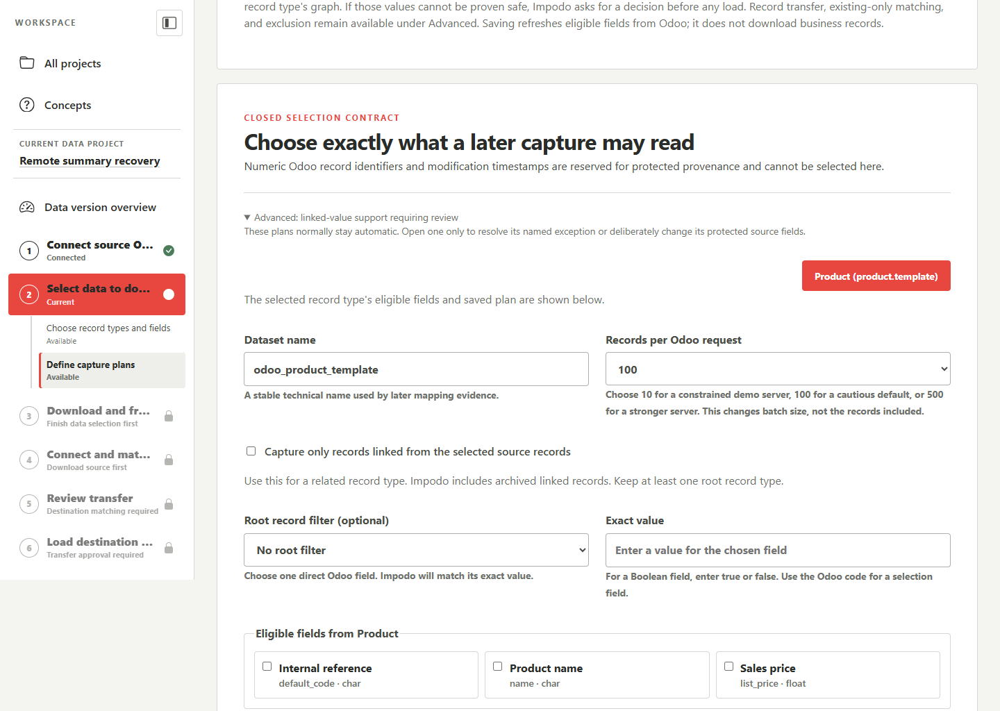

# Save clean Odoo data and restore it after a reset

## Goal

Keep selected clean Odoo records so you can restore them after a test database
reset. You capture the cleaned Odoo data directly and can reuse it without
repeating the original import from AX.

For example, you clean Contacts and Contact Tags in `odoo-dev` for Company
North. You preserve both record types and their links. After the next test
reset, you restore the saved version into the chosen test database.

## What you preserve

There are two levels:

| Level | What it contains | What you do |
| --- | --- | --- |
| **Capture configuration** | The source database and company, selected record types, fields, filters, archived-record choices, and related data. | Save the choices once and revise them when the scope changes. |
| **Saved data** | Dated versions of the records captured with those exact choices. | Select **Update saved data** to capture another complete version, or **Restore all** to use a chosen version. |

Each version keeps its original data and configuration revision. Editing the
configuration changes future captures. It does not rewrite older versions.
**Saved destination** remembers where and how you restore; it does not add
another level of source data to maintain.

## Before you start

Use an Odoo-source workspace in your data project. Connect the source and
choose its models, fields, filters, and related data through
[Odoo data](../workflow/02-odoo-data.md) and
[Source data](../workflow/01-source-data.md). The saved-data page reuses those
choices.

You need read access to the source company when capturing or updating data.
Restoring an existing version needs the saved data and destination access; it
does not need the original source to remain available.

Transfers use the same supported major: Odoo 19 to 19, or final Odoo 20 to 20.
The destination must have compatible models and fields. Installed modules,
required values, and permissions still need to pass the destination check.

## Steps in Impodo

### Save the capture configuration

1. Open the data project and select **Open saved Odoo data**.
2. Review the source database and server under **Capture configuration**.
3. Enter a **Saved set name** and choose the **Source company** fetched from
   that database.
4. Keep **All restorable fields** selected to include eligible scalar business
   fields on each update. Clear it to retain the exact field selection from
   source setup.
5. Use **Edit models, fields, and related data** when the saved scope needs a
   different record type, filter, or relationship choice.
6. Select **Save capture configuration**, or **Save configuration changes**
   when revising an existing set.

Saving the configuration checks its source context and field choices. It does
not download the business records. Related records follow the reviewed source
choices; an ordinary link does not automatically preserve every optional
field of the related model. Select the related business records for full
transfer when their complete configuration is part of your requirement.

### Update all saved data

1. Finish the clean-up work in source Odoo.
2. Open the saved set and select **Update saved data** once.
3. Follow **Current action** until the operation finishes.
4. Review the new version's capture date, configuration revision, and model
   record counts under **Saved data**.

Impodo captures the complete configured scope together. A failed update keeps
the previous complete version. Capture during a quiet period: the Odoo API
reads models over an interval, rather than taking a simultaneous database
snapshot. Impodo stops when its checks detect changes during the capture.

### Check and restore a version

1. Under **Restore a saved version**, choose the **Saved data version**.
2. Choose a **Saved destination**, or enter another destination's address,
   database, company, and approved checking and loading key.
3. Review **How matching records are found**. The selected fields must
   identify one record. If the same identifier occurs under different parents
   or companies, choose the captured relationship under **Match within**.
4. Choose how existing destination records should receive saved values. Use
   the bulk buttons, then expand individual field choices when needed.
5. Select **Check destination** to review access, matches, and schema
   differences without changing Odoo.
6. Resolve **Review the destination differences** and any
   **Required values for new destination records** on the same page. Check
   the destination again after changing those choices.
7. Confirm the named database and company with the restore checkbox, then
   select **Restore all**.
8. Follow **Current action** and select **Review result** when available.
   Check that the destination result was verified.

**Restore all** checks the included models together before writing. It
creates missing admitted records and applies your field choices to existing
matches. After a reset, it starts fresh checks even when the server address
and database name remain the same. A prior restore's approval or recovery
record does not authorize writes into a recreated database.

The chosen destination company controls the operation context. Company fields
and other links on individual records must also resolve correctly. Choosing
the operating company does not silently replace every saved company link.

**Match within** currently supports one direct captured parent or company
relationship. The parent record type must be included, have a standalone
matching identifier and already match exactly one destination record. For
example, a saved operation called `Cut` under `Assembly A` is checked within
that existing assembly rather than against every operation called `Cut`.
Saved destinations remember this relationship together with the matching fields.

A blank relationship, missing or ambiguous parent, or parent that itself needs
a matching scope stops the check. Create missing parents separately before
restoring the scoped records. Other restored record types cannot yet link to
a record type matched within a parent. The selected matching relationship is
part of the identity, so ordinary field policies cannot rename, exclude or
preserve another destination value for it. This choice does not remap source
companies by itself; use the separate destination-value mapping below.

For an existing linked record with a different name or code, expand **Use
different destination values** under **How matching records are found**. Enter
the captured identifier as **Source value** and the exact existing identifier
as **Destination value**, then select **Check destination**. For example,
`Company A` can explicitly use existing destination `Company B`.

This choice is available for existing-only reference record types that use one
matching field and no additional matching scope. The destination value must
have one accessible match. A missing or ambiguous target, unknown source value,
or choice that combines distinct source records stops the check. Impodo keeps
the saved source unchanged and does not rename or update the reference record.
An aliased existing parent can still be the matching scope for its children.

Saved destinations remember the protected mapping choices. Each restore
checks them against the selected data and current destination; earlier approval
does not carry over. Clear both inputs and check again to remove a mapping.
If **Review the saved reference mappings** appears, explicitly confirm the
replacement values before continuing. Leaving those replacement values empty
clears the unavailable mappings.

| Field choice | Existing destination record | Missing destination record |
| --- | --- | --- |
| **Use saved value** | Replace a different value with the saved value. An admitted saved empty value can clear the field. | Use saved values and the reviewed creation providers. |
| **Keep destination value** | Leave the current destination value unchanged. | Use saved values or a reviewed default needed to create the record. |
| **Fill only when empty** | Fill an empty field. Zero and No remain meaningful values. | Use the saved creation value or a reviewed provider. |

For lists of linked records, choose **Replace with saved links**,
**Keep destination links**, or **Add missing saved links**. Replacement can
remove extra links, including when the saved list is empty. It does not delete
the related records. **Fill only when empty** fills a linked-record list only
when it has no members.

Destination-only records remain in Odoo. Extra child records also remain;
Impodo does not delete them to imitate a complete database restore.

### Download or import a protected package

In the version table, expand **Download protected package**, enter a
**Package password** of at least eight characters, and select
**Download version** for that row. Keep the resulting `.impodo` file and its
password where you can retrieve them after a reset.

On the same or another Impodo installation, open the chosen data project,
expand **Import a saved data package**, choose the file and password, and
select **Import saved package**. Impodo checks the complete package before
admitting its data. The imported version can then be restored through the
same destination review.

The package includes the preserved records and the information needed to
rebuild their links. It does not include Odoo API keys or earlier permission
to write into a destination. You need destination access when restoring.
The package password is required when importing.

The package does not include saved destinations or their reference mappings.
After importing on another Impodo installation, create a new destination profile
and enter any **Use different destination values** mappings again before checking
and restoring the data. Existing saved destinations and mappings can be reused
in their original local project; the package does not carry them elsewhere.

## What to check

- Check the source company and the selected related models before capturing.
- Check the dated version you intend to restore and the destination named
  beside **Restore all**.
- Check matching fields for blank or repeated values. A matching name alone
  may be insufficient when the same name appears under several parents.
- Check every excluded, renamed, or newly required field. The retained source
  version keeps the original value even when you exclude it from a restore.

**All restorable fields** is limited to the capture capabilities currently
supported. Company-dependent property fields, translated values, attachments,
and binary content are outside this capture surface. Review accounting codes,
company membership, and required related configuration before relying on a
saved Chart of Accounts. A saved set preserves its reviewed scope, not an
entire Odoo database, its modules, or its transaction history.

## What Complete means

A completed update has one complete dated version of the configured scope.
A completed restore has a verified destination result under the selected
field policies. Kept destination values and deliberately excluded fields do
not mean that every destination value equals the original source.

## What changes and what does not

Updating saved data reads source Odoo. Restoring writes only the approved
destination scope. Both actions keep earlier saved versions available.
Opening the page or selecting **Check destination** does not load records.

## Needs attention

For a removed field, review its exclusion or provide the destination's
technical field name when it was renamed. For a new required scalar field,
choose a valid fixed value or the checked Odoo default.

A required linked value needs a reviewed existing or incoming provider.
Typing a numeric Odoo record ID as a scalar default cannot supply that
relationship. Resolve the related setup or provider before retrying.

If a restore stops after writes have started, open **Review result** and use
the offered recovery action. Some records may already have been written.
Impodo does not promise rollback of the complete restore. Do not resume that
interrupted run after the destination has been reset again.

## What makes this work stale

Changed source choices require a new capture configuration revision. Changed
destination fields, access, company context, matching records, or field
policies require fresh destination checks. A recreated source database also
needs fresh source review; reused addresses or numeric record IDs do not
prove that its records are the old clean data.

A saved destination check or transfer review in a retired format cannot
authorize restoration. Select **Check destination** again, resolve the current
decisions and explicitly confirm **Restore all** for a fresh checked run. The
retained data version stays unchanged. An interrupted restore still needs its
recorded outcome reviewed before another load starts. Its retired approval
cannot authorize another load or resume an interrupted write.

## Next stage

Use the verified result to continue testing in Odoo. Before the next database
reset, finish your clean-up and select **Update saved data** again if the
preferred preserved data has changed.

## Related documentation

- [Choose source Odoo data](../workflow/02-odoo-data.md).
- [Capture source records and related data](../workflow/01-source-data.md).
- [Review and load an Odoo-to-Odoo transfer](../workflow/06-load-into-odoo.md#odoo-to-odoo-transfer).
- [Developer implementation and verification](../../developer/workflow/02-odoo-data.md#saved-odoo-data-and-repeat-restoration).
