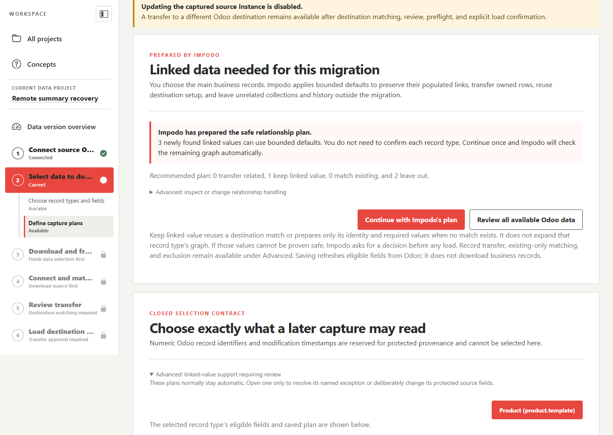
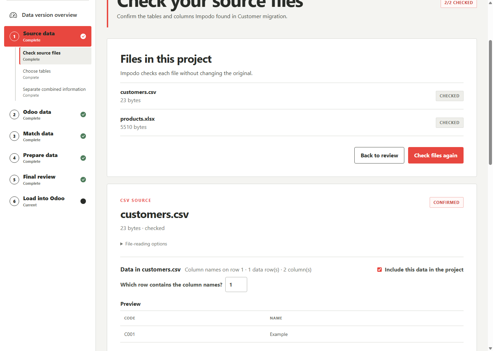
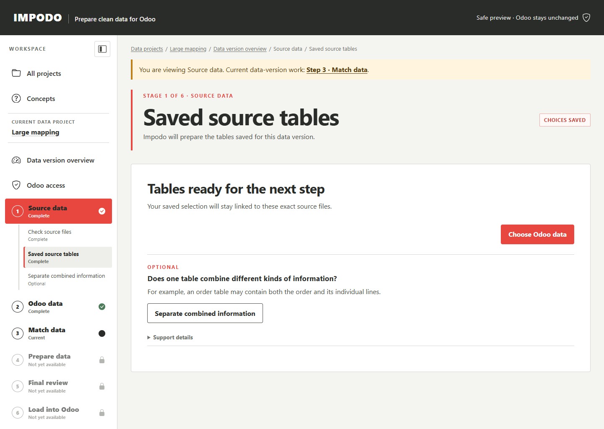
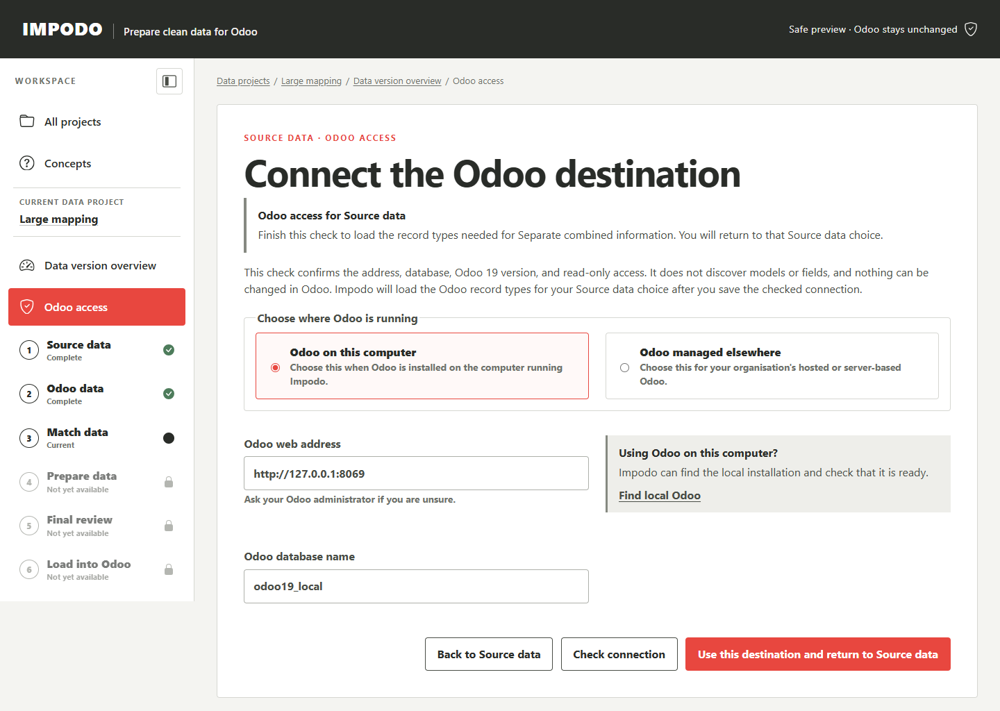

# Source data

## Goal

Confirm the exact records and columns that Impodo may prepare, then freeze
them as evidence for the current data version.

## Before you start

The current data version must be available. For files, use the complete CSV
or XLSX delivery for this authoring work and know which
worksheets, tables, or ranges belong to the migration. For an Odoo source,
first complete the eligible-field capture described in
[Odoo data](02-odoo-data.md).

## Steps in Impodo

### File source

1. Add all related CSV or XLSX files and select **Use these files and
   continue**. Impodo checks the files and opens the source preview.
2. Review the delimiter or worksheet, headings, bounded preview, counts, data
   types, blanks, repeated values, and warnings.
3. Configure the intended tables for every file.
4. Add a corrected file and remove the wrong file if necessary.
5. After every file is confirmed, give each table a **Name shown in Impodo**
   and select **Save tables for this data version**.
6. Optionally open **Separate combined information** when one table contains
   several business realities or several tables contain partial views of the
   same reality.

Choose **Several tables describe the same records** when one primary frozen
table and up to nine added tables describe the same business record. Name the
logical output, choose the primary table, define one to five exact typed key
fields once, and confirm the corresponding fields for every added table. The
primary table defines what one output row represents. Include company,
partition, or another scope field when an identifier is not globally unique.

Select **Review complete combination**. Impodo checks every accepted row and
shows one reconciliation row for each added table: matched and unmatched
primary rows, unused added rows, invalid keys, repeated keys, and final output
rows. Select **Save combined table** only when the primary grain is preserved.
The physical inputs default to preparation-only, private intermediate tables
do not create separate mapping work, and only the final logical output enters
**Match data**. Use **Advanced: combine two tables** when an explicit pairwise
structural step is needed.

For a BoM delivery, combine partial header tables only at the header grain and
partial line tables only at the complete line grain. Keep repeating operations
as their own dataset. In **Match data**, link the line and operation datasets
to the incoming header instead of flattening them onto it. The
[related-table guide](../guides/related-tables.md#combine-partial-views-of-the-same-records)
shows the qualified three-dataset result.

For **Create a related table from one field**, select **Review resulting
table** after choosing the source field and Odoo record type. Impodo checks
every accepted source row and shows the expected table size, repeated values,
unusable values, extra parent rows, and spelling differences it will combine.
Select **Add related table to Match data** only when that result is correct.
The original source table stays unchanged, and this action does not create or
change Odoo records.

For **Create two related tables**, the original table is hidden from **Match
data** by default. Choose **Yes - also keep the original table** only when
different rows from that one table need a separate mapping. Then use **Rows to
use** in **Match data** to keep those row populations disjoint. The accepted
source remains unchanged whichever choice you make.

Some related-table choices need the list of record types from your Odoo
destination. If only the read-only key is missing, select **Enter key and show
Odoo record types**. Impodo saves the key for this destination, loads the list,
and keeps you on the same Source data choice. If the destination itself needs
setup, select **Set up Odoo access**. Check the connection and select **Use
this destination and return to Source data**. Impodo loads the record types
and returns to the choice you opened. **Odoo access** is a shared setup page
outside the numbered stages; Stage 2 begins when you choose the Odoo data to
use.

For example, if a Product file has separate category levels, you can start
the hierarchy in Stage 1, check Odoo access when prompted, and then finish
the hierarchy without searching for the same source table again.

For a multi-column parent-and-child hierarchy, follow [Prepare related
tables](../guides/related-tables.md#build-a-hierarchy-from-separate-fields).

Once table choices are frozen, the file list cannot be changed in that data
version.

### Odoo source

1. Open **Download and freeze** after eligible fields have been captured.
2. Review **Linked data needed for this migration**. You do not have to
   confirm every related record type. Impodo prepares one bounded plan:

   - a direct many-to-one value normally uses **Keep linked value**, which
     reuses an exact destination match or creates only the identity and
     required values needed to preserve that link;
   - an owned collection or common related business record identified by a
     versioned profile uses **Transfer related records as migration data**, so
     quantities, durations, schedule hours, and other selected business values
     are retained;
   - destination setup such as Company uses **Use existing destination records
     only**; and
   - an unclassified one-to-many or many-to-many collection uses **Do not
     include** instead of widening the migration silently.

   Select **Save linked-data choices** once. This is separate from saving the
   fields for one record type. Impodo saves the linked-data choices, refreshes
   any newly reached record types, and applies the same bounded rules for up to
   four steps. If you change a linked-data choice and then try to save fields,
   Impodo stops you and points back to **Save linked-data choices**. Your
   browser also warns you before a refresh or page change can discard an
   unsaved choice.

   After a successful save, **Your saved linked-data choices** remains visible
   when you refresh the page. Impodo recalculates its automatic recommendations
   when the plan changes, but it keeps a deliberate choice made either in a
   named exception or under **Advanced** while that choice remains valid.

   Select **Companies** as a main record type only when you intend to migrate
   company records themselves. If you need Company only to connect the main
   records to a company that already exists in the destination, leave it as
   linked data. Impodo then prepares only **Company Name** for matching.

   The ordinary page shows only a real exception, such as unavailable metadata
   or one related record type reached through links that require incompatible
   destination policies. Open **Advanced: inspect or change relationship
   handling** only for an unusual migration or to override a recommendation.
   The complete currently applicable matrix and all safe alternatives remain
   available there.

   If Impodo discovers a policy conflict while it follows newly included
   records, it saves the safe review progress and returns you to this same
   section. It does not create capture plans yet. Choose one outcome in the
   named relationship exception, then select **Save linked-data choices**
   again. Impodo resumes the linked-data review in the same project.

   Some read-only lists are calculated by Odoo from another relationship. They
   stay under Odoo-managed handling and do not create a second choice or a
   conflict with the linked value that owns the relationship.

   Each time you rebuild this plan, Impodo recalculates its automatic handling
   from your current main record types and current recommendations. It remembers
   the choices that you deliberately made in a named exception or under
   **Advanced**. An automatic choice saved by an older Impodo version does not
   make an old supporting record type part of your intended migration.

   Impodo first completes the required Odoo reads without changing the project.
   After those reads succeed, it publishes either the complete linked-data and
   capture plan or the resumable review checkpoint described above. If Odoo
   times out or cannot be reached before that point, your current choices and
   plans stay unchanged. Keep this project open, restore access if necessary,
   and select the action again. You do not need to choose the main record types
   again or create another project.

   

   **Keep linked value** does not follow optional relationships from its
   related record. Full transfer also checks the linked data that record needs.
   Existing-only captures the value needed for matching and permits neither
   creation nor update. A standard manufacturing profile can therefore
   transfer reached BoM lines, operations, Work Centers, Working Hours, and
   working-time rows without making those models rules in the generic engine.
   If a required related record type is unavailable, Impodo names it as a
   blocker instead of treating it as excluded.

   Saving a changed main model choice refreshes its eligible fields from Odoo
   and requires you to review the affected capture plans again. A record type
   added from this section starts with **Capture only records linked from the
   selected source records** selected. Use **Review all available Odoo data**
   only when you need to change the wider main-record scope. Automatically
   linked record types remain visibly separate and are not checked as main
   record types.
3. When the related-data plan is complete, select **Prepare capture plans**
   when that action is shown. Impodo prepares every capture plan it can prove
   safely. Main record types receive their eligible business
   values. Full related records receive the same full plan. Existing-only
   records receive identity evidence, while **Keep linked value** records
   receive their identity and required values only. A successful rebuild
   publishes one complete generated set. If you edited a capture plan before
   rebuilding linked data, review the regenerated plan again. If one record
   type has no safe identity or exceeds a capture limit, the page names that
   exception and opens only that plan for review. You do not need to configure
   all the other record types individually.

   Review the saved-plan summary before continuing. It lists the main record
   types first and summarizes automatic linked-value support separately. An
   automatically prepared root plan reads all matching records and remains
   subject to the 10,000-row safety limit. Select **Edit saved capture plans**
   if you need to add an exact **Root record filter**, change the fields, or
   change the request size. A related plan remains limited to records reached
   through the reviewed links.
4. If Impodo included linked support, review **Relationship fields used to
   find linked records** and confirm **I reviewed the selected relationship
   fields above**. Then select **Count selected source records and continue**.
   Impodo shows the count and request estimate for each dataset and for the
   complete capture.
5. Confirm the read-only action and wait while Impodo freezes every dataset as
   one source version. A failure leaves the previous complete version current.

If you return to this stage and change the selected Odoo record types, fields,
or capture plans, Impodo locks the later stages immediately. Complete a capture
plan for every selected record type, then confirm **Download and freeze** again.
Impodo does not combine the earlier frozen records with the new choices. The
earlier version remains protected history until the new complete version is
frozen.

The Odoo-source route reads selected business records; it does not authorize a
write back to Odoo.

Selected record types remain separate datasets. Capturing both ends of a
relationship gives **Match destination data** the records and protected link
evidence it needs. A link to an unselected record type is not transferred. The
related-data proposal explains why each available link may or may not belong
in the migration. Its technical model and field names remain under **Support
details**. The ordinary page does not require a separate choice for every
technical field. A completed plan records the current result for each displayed
link. On a later rebuild, Impodo recalculates automatic results and carries only
your deliberate named-exception and **Advanced** choices. It finds reached
supporting records
from the selected relationship fields. It stops if a referenced record is
missing, inaccessible, or outside the selected root group. Capture alone does
not authorize recreating records in another Odoo instance.

The root filter currently matches one direct field by exact value. Editing
other plan choices keeps a saved filter. Enter a new field and value to replace
it, or choose **Remove the saved root filter** to remove it. Related record
types kept by a relationship receive automatic linked-only plans; they do not
become main record types. Impodo follows only reviewed links, up to four steps.
The Advanced interface groups only compatible fields while retaining a
separate saved decision for each field. If edges to one model imply different
model-wide destination policies, Impodo saves a resumable review checkpoint and
shows one named exception instead of collapsing them silently. The checkpoint
contains the Odoo details needed to present that exception, but no capture
plans. Your deliberate choice lets the same review continue.

Impodo accepts finite Odoo floating point values such as quantities, rates,
and durations in this source capture. Review the captured values before
loading another instance.

## How Recipes reuse this work

The exact files, rows, hashes, and frozen snapshots belong only to this data
version. A saved Recipe retains the reusable source shape and logical
table and column bindings, not the source records.

When a Recipe contains combined or separated tables, it also retains the
ordered preparation rules and whether each physical input was used only for
preparation or also mapped directly. A later Test delivery may use different
file names, but it must supply one unambiguous compatible table for every
physical input. The fresh preparation checks the current rows again and stops
if a saved rule is no longer satisfied.

Every later data version must therefore start clean and accept its complete
replacement delivery again. An integrated Test run can select different
logical datasets from one already accepted Test data version for several
Recipes; it still never reuses the Authoring rows as current Test evidence.

## What to check

- Counts and headings match the governed export or every Odoo selection.
- Preview values belong to the intended business population.
- Stable business identities are present.
- Warnings are understood before freezing.
- Optional related tables represent real record types, not merely convenient
  display groupings.

## What Complete means

Impodo shows the source stage as frozen or complete only after every selected
Odoo record type has a saved plan and the complete set has been captured.
Every selected dataset is bound to protected evidence for this data version.

## What changes and what does not

Freezing creates a governed snapshot for preparation. It does not modify the
original file or Odoo records, save a Recipe version, or copy evidence
from another data version. Optional related-table and combined-table rules
create a plan; they do not rewrite the frozen source.

## Needs attention

Stop when a file hash has changed, a worksheet is missing, headings are wrong,
or the Odoo capture is broader than intended. Before table freeze, replace an
incorrect file. Never replace frozen evidence in place. If the migration scope
is wrong, create a correctly scoped data project.

For combined source information, use the
[related-table and combined-table authoring guide](../guides/related-tables.md)
instead of manually altering the project database.

## What makes this work stale

A changed source file, table choice, Odoo selection, or related-table plan
changes this data version's source evidence. Downstream schema, mapping,
preparation, and review evidence must be regenerated when Impodo invalidates
them. If you open a saved later-stage link after such a change, Impodo returns
you to the unfinished Source data choice instead of starting preparation.
Earlier data-version evidence remains protected history.

## Next stage

For a file source, continue to [Odoo data](02-odoo-data.md). For an Odoo
source, continue to **Connect destination Odoo** after the complete capture is
frozen. You then match destination records, validate relationship order,
approve the transfer, and run the read-only destination preflight. When it
passes, continue through Stage 6 to prepare the exact load, explicitly confirm
it, and verify the destination result.

## Related documentation

- [End-to-end training tutorial](../tutorials/end-to-end-training.md)
- [Developer implementation: Source data](../../developer/workflow/01-source-data.md)
- [Planned same-database guarded Odoo-source updates](../../plans/00-remaining-work.md#4-complete-guarded-odoo-source-updates)
