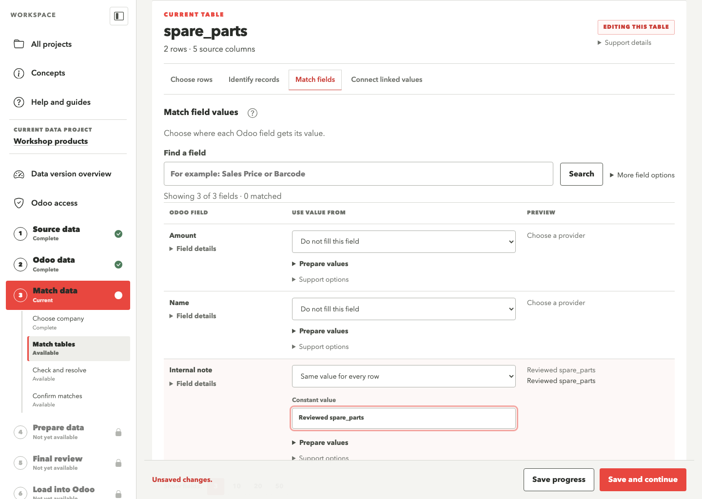
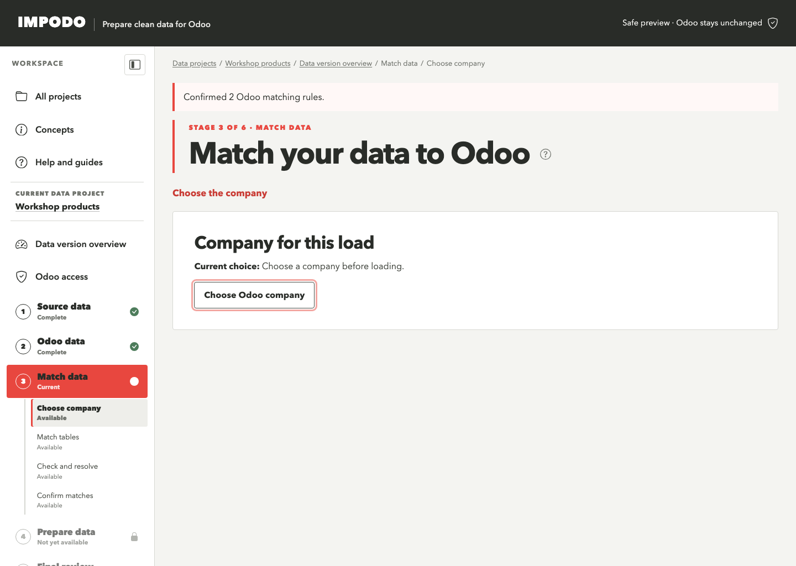
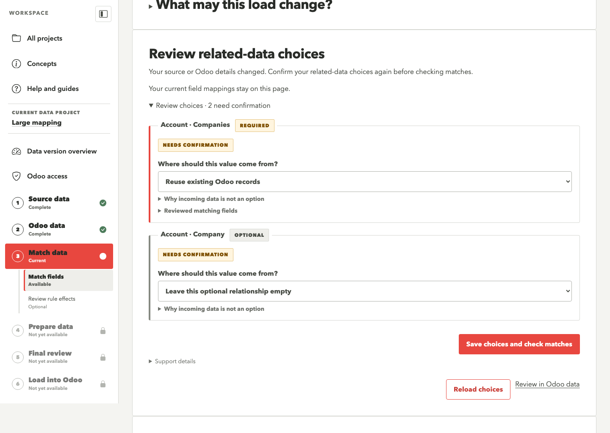
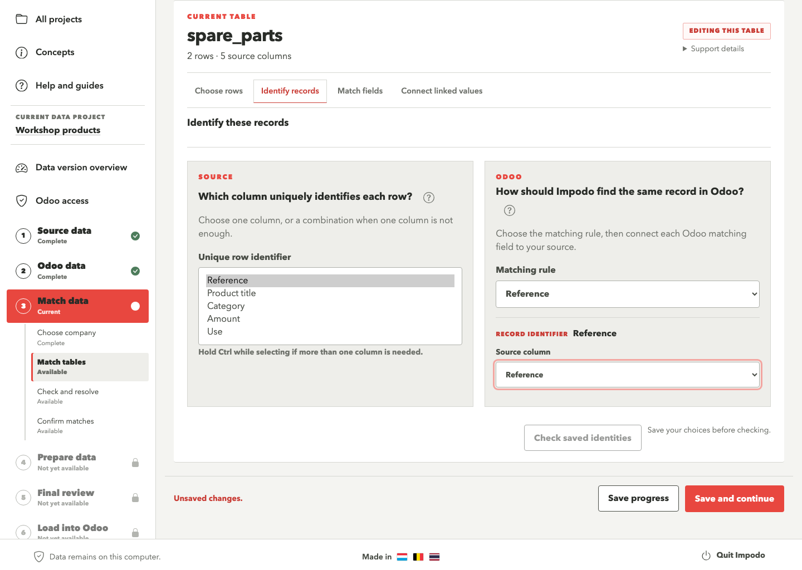
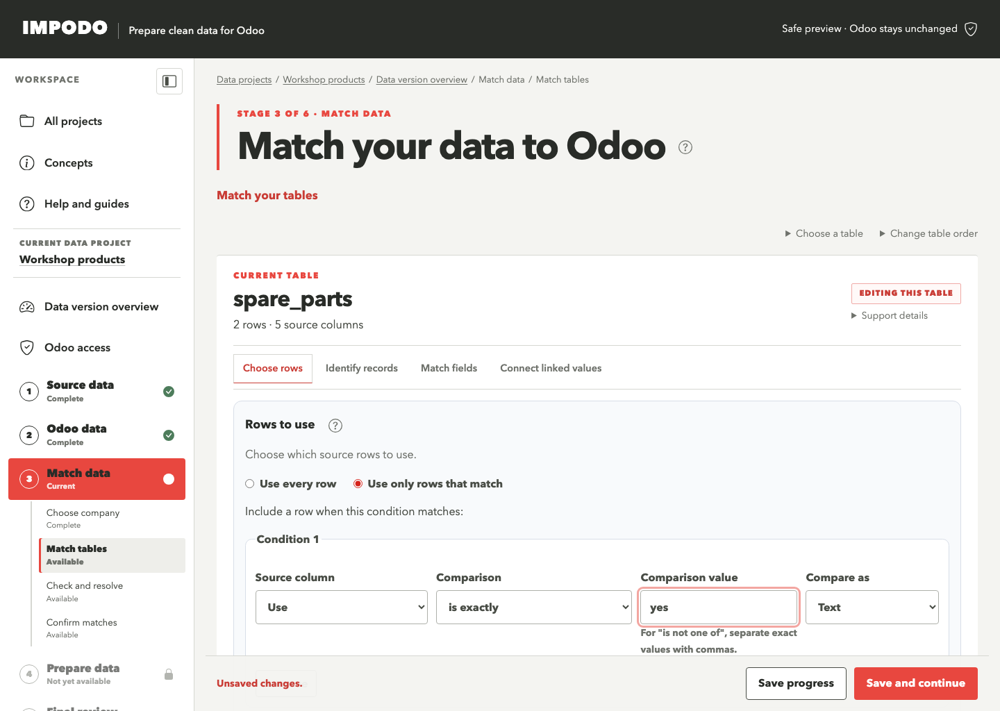
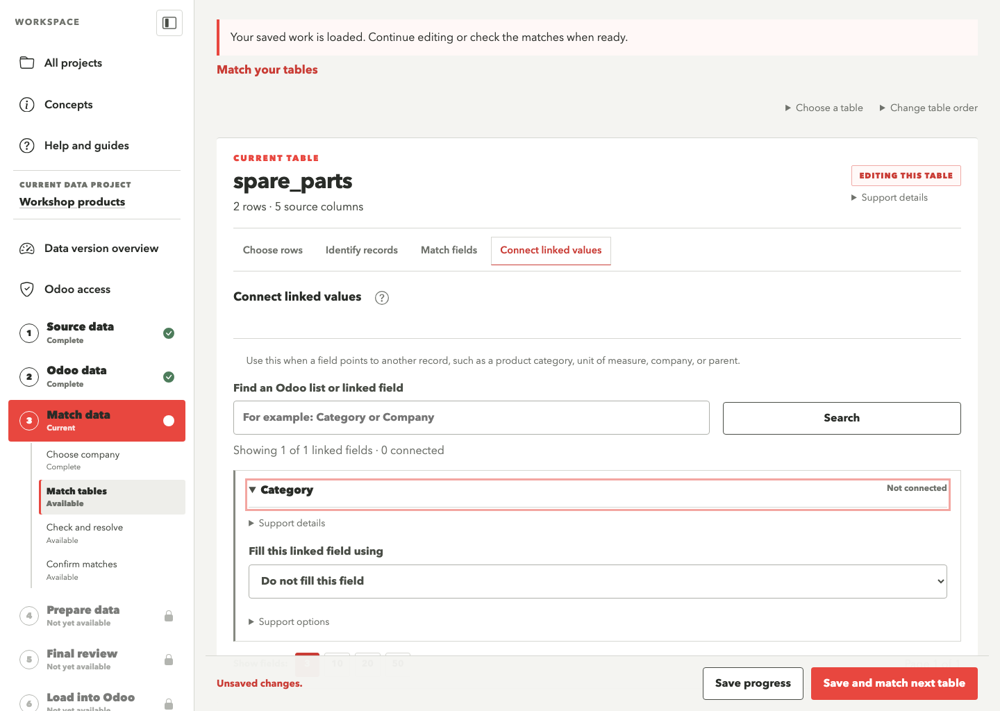
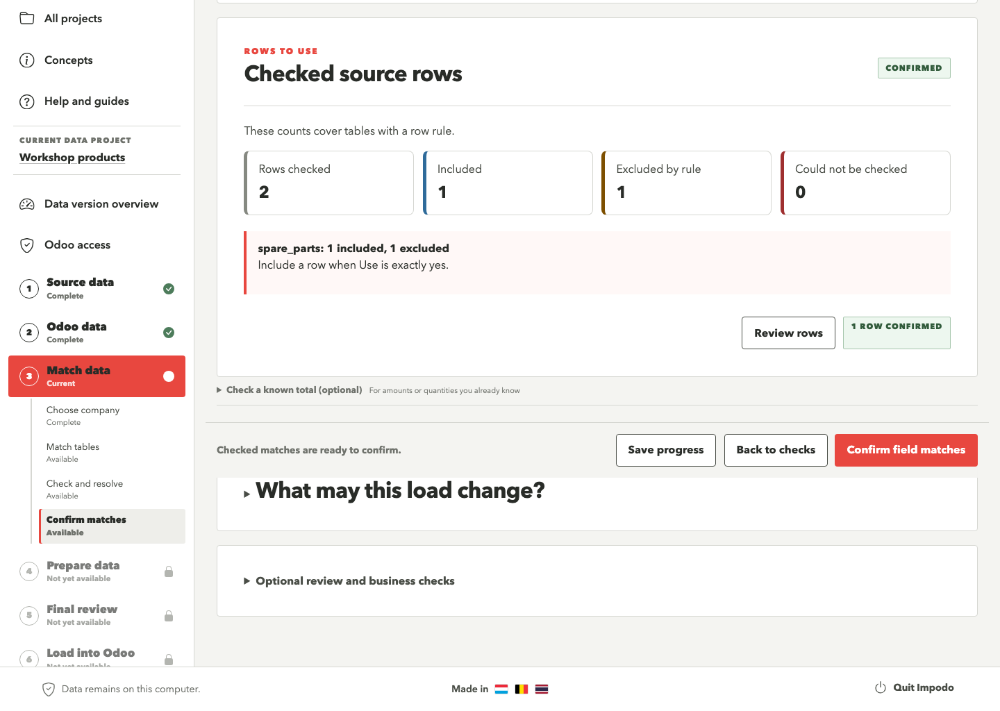
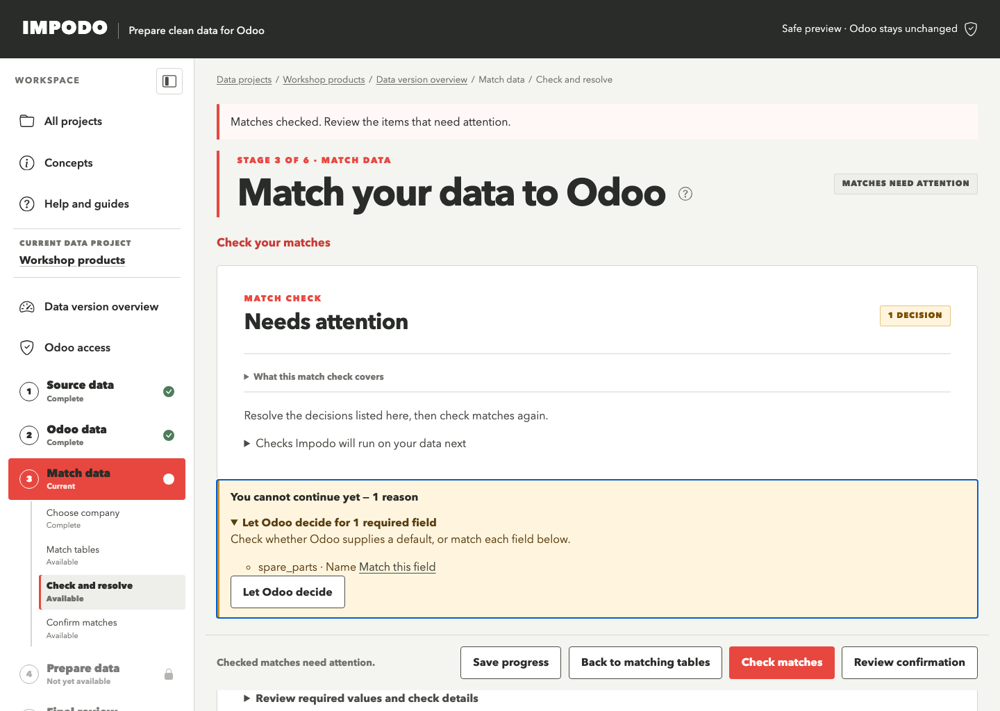
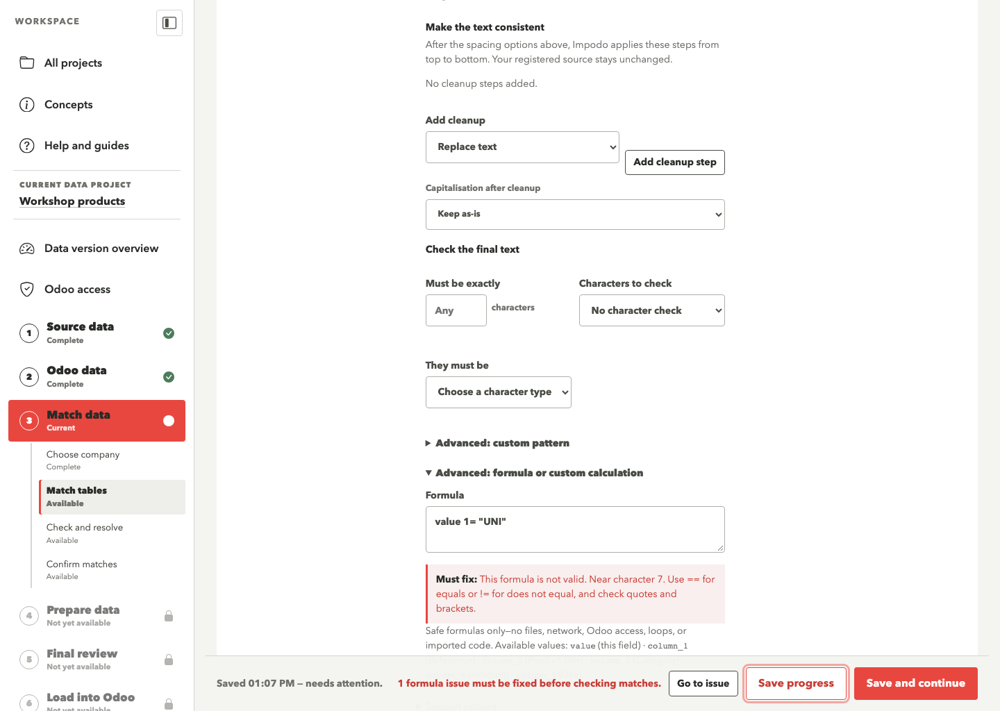

# Match data

## Goal

Match your source tables to Odoo, choose their field values and linked records,
then check those choices before preparing the data. In authoring, you can later
save these reusable rules as a Recipe version.

## Before you start

Confirm your source data and Odoo choices before starting Stage 3. For file
imports, decide how to identify records and supply required values and links.
Captured Odoo records keep their protected record identity automatically.

You can use a saved combination of two source tables for field values and
linked records, including one created with **Advanced options** → **Combine
two tables**. Select **Check matches** to check its saved values and choices.
If Impodo reports an outdated combination review, review that combination in
**Source data** before checking matches again.

## Steps in Impodo

Stage 3 has four sidebar steps. Saving progress, checking matches, and confirming
matches remain separate actions.

1. **Choose company.** Select the company for this load, then select
   **Use this company and continue** to open the table editor. When you return
   with a company already chosen, Impodo opens the table editor.
2. **Match tables.** Work through the recommended order, one table at a time.
   **Choose rows** sets which rows to use and what to prepare. **Identify
   records** connects the source identifier to the Odoo matching rule.
   **Match fields** chooses source values, fixed values, defaults, and any
   cleanup rules. **Connect linked values** chooses the related records each
   row uses. Select **Save and continue** to save before moving to the next
   task. At the last task, **Save and match next table** moves to the next
   table. **Save and review matches** opens the checks after the last table.
   Captured Odoo records keep their protected identity and omit tasks that do
   not apply. Use **Choose a table** to revisit a table and **Change table
   order** when you need a different working sequence.
3. **Check and resolve.** Select **Check matches** after completing the table
   choices. Correct the listed decisions using their field links, then return
   to the checks. **Go to issue** reveals a formula even when another task is
   visible. Detailed counts and required-field coverage remain under
   **Review required values and check details**.
4. **Confirm matches.** Review included and excluded rows. When a rule excludes
   rows, select **Confirm N rows to use** for the checked selection. Review any
   required warnings, then select **Confirm field matches** to continue to
   Prepare data. Optional Excel review, rule effects, and business checks are
   available here. Opening this step does not confirm or approve anything.

Each field row shows **Odoo field**, **Use value from**, and **Preview**.
Open **Prepare values** only when you need conversion, cleanup, rounding, or
validation. **More field options** contains the matched-field and read-only
filters and the action to check for changed Odoo fields. A field's
**Support options** contains its comparison and required-value settings.

In **Choose rows**, **Create new records or update matches** updates only
matched fields whose values differ from Odoo. Other fields stay unchanged.
**When a record already exists** appears only for **Create new records only**.
Choose whether an existing match stops for review or stays unchanged.

Choose **Update existing records only** when your file supplies changes to
records already in Odoo. Each row must identify one existing record through
your confirmed matching rule. You can leave creation-only fields unmapped.
For example, to archive accounts, match their current account codes in the
chosen company and map only **Active** to `False`. Account Name and Type keep
their existing values. Select **Save progress**, then **Check matches** and
continue through preparation to Final review. The comparison must show zero
new records. Missing or ambiguous matches block loading.

**Use existing Odoo records only** makes a table available for references. It
does not apply changes to those records.

Review **Blank source values** beside each field's value choices in **Match
fields** and **Connect linked values**. For a field that holds one value,
**Ignore blank source values** keeps the existing Odoo value when the prepared
source value is blank. Other blank policies can clear it. For lists of linked
records, also review whether to replace, add to, or remove from the current list.

Use **Let Odoo choose** only when the checked target supplies a default, or
**Odoo manages this field** when Odoo creates or maintains it. Choosing an Odoo
default saves that decision and checks the mapping. Other field changes need
**Check matches**. A malformed formula can still be saved for correction.

To fill an Odoo date field such as **Valid From** from an Excel timestamp,
choose the source column, open **Prepare values**, and set **Value type** to
**Date**. Under **Input format**, select **Excel date and time (keep date
only)**. Impodo takes the calendar date from an Excel date-and-time cell or
month-first timestamp text.
For example, `10/21/2019 5:54:30 PM` becomes `2019-10-21`. Review the preview,
select **Save progress**, and then select **Check matches**.

### Choose the company for this load

Uploading files does not assign their records to a company. Choose the company
whose Odoo settings you want to use when checking and loading them. For example,
Odoo can keep different fiscal positions and payment terms for Northwind Factory
and Northwind Trading. The selected load company tells Odoo which company's
settings apply. You do not need to add a Company column just to upload a file.

In **Choose company**, open **Company for this load** and select
**Choose Odoo company**. Impodo shows the checking user, that user's default
company and their available companies. Choose **Odoo company**, then select
**Use this company and continue**, even when only one choice is available.
Impodo opens **Match tables**. **Check matches** automatically refreshes the
saved Odoo record-type and field checks when the checking-key setup or selected
company has changed. It keeps the edits submitted with that check.
When you open **Match source choices** for a linked field such as **Unit**,
Impodo also checks the fields under the selected company if the previous
check used a different company context.
You can also save progress and select **Check company-specific values** to
refresh explicitly before reviewing individual defaults or linked values.
The connection and record types have already been checked in Odoo data.

When you open Match data without a chosen company, Impodo brings **Company for
this load** into view, even if it remembers an older field position. A direct
link to a specific section still opens that section. Once you choose a
company, ordinary returns can restore your last field position.

For example, Northwind Group can be the user's default company while this
load belongs to Northwind Factory. Select Factory to check, load and verify
company-specific values there. The user's default remains Group.

The load company and a record's **Company** field serve different purposes.
Selecting the load company does not fill that field. A shared record stays
shared when its mapped company is blank. Odoo's rules determine which shared
or parent-company linked records are valid. The checking and loading users
both need access to the load company; their API keys can belong to different users.

Each reviewed load uses one operating company. For files covering several
companies, use the saved row-inclusion rules to select the relevant records
and review a separate run for each company. Impodo does not switch operating
company automatically for each row.

You can correct the company in the same authoring project. Accepted files,
combined tables and saved field matches remain. Check company-specific values,
refresh linked-value choices, check and confirm the matches, then prepare and
compare again. A company-only refresh preserves saved matches when fields and
access are unchanged. Re-entering a checking key gives its saved setup a new
version, even when the key text is the same. **Check matches** refreshes that
verification before it reads the linked Odoo choices. A repeated check with the
same current setup does not repeat the field refresh. This keeps your matches
when the same Odoo user, permissions and fields are verified.
If the company and selected sources also remain the same, Impodo keeps your
related-data choices and checks them again automatically.
Other changes require the normal schema review. Verify
an active or uncertain load before changing its company.

If a refresh makes your related-data choices outdated, **Review related-data
choices** appears in Match data. Keep or correct the displayed selections,
then select **Confirm choices and check matches** above or below the list. Impodo
saves those choices before checking the field mappings currently on your page.
If saving fails, your entered mappings remain visible. **Reload choices**
reloads only the related-data controls.

If a saved choice disagrees with a field rule, **Correct linked fields** names
the affected fields. Select **Review this field**, correct its source or
matching rule, then select **Check matches**. The field opens even when it is
on another page of the field list. For example, choosing Northwind Factory under **Company for this
load** does not fill an account's **Companies** field. To assign that company
to every account, connect **Companies** using **The same existing Odoo record
for every row** and select Northwind Factory. Keep the existing account
401100 Customers in the separate **Parent Account** field.

A Recipe keeps reusable transformations and business keys. It does not copy
the authoring database's company number into another run. Choose the new run's
company before activation and check its company-specific defaults and linked
values again. Explicit company names inside saved rules stay literal; review
or parameterize those rules rather than expecting automatic substitution.
An activated run keeps its company fixed, so use a fresh run for another
company. Review business expectations for each run too; a Recipe does not
approve create or update counts for future deliveries.

Projects saved by the earlier company-selection build are upgraded in place.
Their files, combined tables, matches and load history remain. Confirm the
company here before continuing with fresh checks.

For Odoo-to-Odoo transfers, the company control appears in **Match destination
data** after checking the destination connection. A changed company requires
another destination check. The frozen source keeps its own independent context.

### Set business expectations

After checking field matches, open **What may this load change?** in
**Confirm matches**. Choose **Allowed changes** for each record type, optionally set
minimum and maximum new or changed records, then select **Save business
expectations**. Empty counts mean no limit. A maximum of **0** means no records
of that kind may be written.

For example, after a load created 150 company chains but no people, keep the
same project and tables. Choose **Reuse existing records only** for Company
chains and set both maximums to **0**. Allow the intended creates or updates
for People. Prepare and compare again. All 150 chains must match existing
records; a missing chain blocks loading before any write. You can review the
matches without deleting those chains or recreating the project.

**Limit which matched fields may change** can narrow value fields and linked
changes separately for new and changed records. These limits cannot add
permissions beyond the checked mapping. Saving expectations does not load or
approve data. When a current comparison exists, Impodo checks its saved totals
against the new expectations locally; otherwise compare again in Final review.
These expectations govern prepared file imports. Odoo-to-Odoo transfers keep
their destination-owned matching and approval controls.

### Review a field's rule effects

After **Check matches**, return to **Match fields**. The field's **Rule effects**
summary shows the saved counts for that check. Select **Review this field’s
rule effects** to open the review filtered to the exact table and field.
When an edit marks the counts **Needs refresh**, check matches again before
using those counts to judge the revised rule.

### Review required values across tables

In **Check and resolve**, open **Review required values and check details**,
then select **Review required values** to see how required fields get their
values. Opening the checklist uses saved evidence;
it does not contact Odoo, capture defaults, or evaluate source rows.

**Coverage across tables** separates identity proof, required-parent proof,
the match check, and required-field decisions. A chosen identity or parent is
not yet proof that every current record resolves. A checked field rule does
not establish how many records will be created. Prepare data and Final review
still own those checks.

The **Required-field checklist** shows each field's provider: **Source value
or rule**, **Fixed value**, **Checked Odoo default**, **Odoo-managed**, or
**Missing**. An unverified default is labelled explicitly. **Chosen · not
checked** identifies saved decisions; **Checked** identifies current evidence.
**Missing decision**, **Needs attention**, and **Needs refresh** identify work
that remains. Reference-only tables and pinned updates do not inherit
create-only requirements.

For example, a checklist can show a source column for **Name**, a fixed
**Country**, an Odoo default awaiting confirmation for **Language**, and a
missing decision for **Salesperson**. It shows how values will be supplied
without copying private fixed values or Odoo record IDs.

Filter by **Table** or **Status**. Pages show up to 100 fields. **Review field
decision** opens the exact identity, value, or relationship control, including
when fields share the same label. **Review Odoo requirements** returns an
unavailable field to Odoo data. A conflicting read-only write leads to the
existing match-check recovery.

When captured defaults need confirmation, select **Review checked defaults**.
Match data shows the existing grouped acceptance action and checks the complete
mapping once after acceptance. It then shows only the remaining blockers.
Save and check other corrections before relying on the updated checklist.

### Check record identities

In **Identify records**, choose the source column that identifies a row, then
connect it to the confirmed Odoo matching rule. A source identifier and an Odoo
matching rule are separate choices, even when both use **Reference**.

In **Match tables**, **Check saved identities** tests your saved record choices.
The detailed **Identity health** results under **Check and resolve** separate
three facts:

- **Suggested** means Impodo can propose a governed Odoo matching rule, but
  the current mapping has not saved it.
- **Chosen - not tested** means the source identifier and Odoo rule are saved,
  but they have not been proved against current data.
- **Tested on current data** means the explicit read-only check examined the
  included source rows and the Odoo records visible to the current read user.

After **Save progress**, select **Check saved identities**. One bounded Odoo
read also updates the relationship-based table-order suggestion. For each
direct text, integer, date, date-time, or Selection identity, the card reports
included rows, unique source identities, blank identity rows, repeated source
rows and groups, exact and ambiguous Odoo keys, new candidates, existing
matches, and blocked rows. The card never exposes source key values or numeric Odoo
record IDs to the browser.

If a card says **Tested - needs attention**, use its review action to inspect
the cause. Blank identities need a source value or a different row rule.
**Review repeated source identities** opens **Compare duplicate rows**. The
identity issue's **Review [table] identity** action opens the same dialog when
source identities repeat. **Review ambiguous Odoo matches** opens the
source rows and matching Odoo records observed by this check. For example,
`DUP` within Site `BE` remains a different identity from `DUP` within Site `LU`.

On the read-only group page, select **Open complete group** to keep the review
on one group. Pages show up
to 100 members and retain that group while you move forward or back. An
**Included source position** numbers a row within the included population of
this check; it is not a physical file row number. An **Observed Odoo match**
numbers the matches seen by this bounded check. The page does not expose Odoo
record IDs or claim a complete inventory of the target database.

In **Compare duplicate rows**, review each group of source rows with the same
complete business key and scope. The dialog shows every source column and
highlights values that differ among the displayed members. Select **Exclude**
beside each row you want to leave out, then select **Review exclusions**. The
preview shows how many rows will remain, which displayed groups still need
attention, and which incoming relationships may be affected. It counts direct
parent links and identifies other linked fields that need separate review.
Affected rows include records you may want to keep. The affected count is not
a recommendation to exclude them all.

Select **Apply exclusions and check identities** to add the selected unique
source identifiers to **Rows to use** and start another saved-identity check.
For example, when `ROW-1` and `ROW-2` share the same product reference, you can
exclude `ROW-1` and keep `ROW-2`. Impodo excludes the unique source identifier,
rather than every row with that product reference. The accepted source data
remains available. To restore a row, remove its identifier from the exclusion
list in **Rows to use**, then save and check again. Existing conditions and
exclusion values are preserved.

Your checkboxes are enough to choose the rows. When the saved matching
identifier repeats, Impodo automatically finds and checks a column that can
distinguish the selected rows. For example, you can keep matching BoM versions
by `bomID` while Impodo uses `RecID` to save the exclusions. The preview names
that column, and your saved matching choices stay in place.

Impodo checks the exclusion column against all included rows, including rows
outside the displayed duplicate groups. It keeps an explanation visible if it
cannot save the selection safely. It asks you to review the rule manually when
a parent rule, an **any** condition, the condition
limit, or an identifier that cannot fit an exact list prevents a safe addition.
It rejects a selection that would exclude every row or affect unselected rows.
Save unsaved matching choices and check current data before opening the review.
Pages contain at most 100 duplicate members; apply a page's selections before
moving to another page. Restricted data uses the manual source-key workflow.
Recipe runs retain their fixed rules and require a revised Recipe to change
exclusions.

After applying, use **Check matches**, review the complete included and excluded
population, and confirm **Rows to use** before continuing. Linked child rows
keep their parent link when another included row retains the same parent
identifier. If you exclude its last included copy, child rows remain included
unless their own rule follows the parent's included rows.
Their required relationships must still resolve. Exclusion rules can carry
into a published Recipe, and each new Data version requires its own checked
confirmation. If the new identity check cannot start, the dialog keeps the saved
result and offers **Try again** and **Review saved Rows to use**.

If both repeated records belong in the migration, review the matching rule or
correct the source instead of excluding either record. The read-only group
page remains available from the review link when JavaScript is unavailable.
Ambiguous Odoo identities need a
stronger governed Odoo matching rule. Opening a group does not merge rows,
choose the first Odoo match, or approve a collision decision. Use **Review
matching rule** for the correction and run **Check saved identities** again.
If the review belongs to an older check, Impodo asks you to check again first.

The check can also prove related-record components in a complete identity,
such as **Product Reference within Company**, when every related record in the
chain has a confirmed business key. Impodo follows the saved related identity
from the deepest key back to the owner and tests the complete owner identity;
it never tests only a displayed name as if that proved the scoped rule. If a
related key is missing or ambiguous, select **Review unresolved identity
choices**. The protected review shows the deepest unresolved field path, at
most 100 choices at a time, and the Odoo and incoming match counts. You can
filter by table, identity field, or reason, then return to the exact matching
rule. Paging and filtering do not contact Odoo; save the correction and run
**Check saved identities** again.

Impodo limits this early proof to five related-key levels. A cycle, a deeper
chain, or a related key whose saved structure is ambiguous remains **Chosen -
not tested**. It is never flattened into an unsafe text-only comparison.

Odoo counts reflect the records visible to the current read user and company
context. The check cannot claim that an access-hidden record is absent. A
changed source selection, schema, governed rule, mapping draft, target, or read
identity changes the card to **Needs refresh**. This authoring result does not
authorize a load; **Final review** repeats the authoritative destination
comparison.

### Find missing parents before preparation

After you save linked fields, **Relationship health** tests the actual values
used by the included source rows. Select **Check saved relationships**. Impodo
then groups the distinct keys into bounded read-only requests; it does not make
one Odoo request for every source row.

Each relationship card keeps the expected origin visible. A value can resolve
to one existing Odoo record, one record in the selected incoming table, or the
incoming table only after Odoo has no exact match. Impodo reports missing,
ambiguous, case-only, and incomplete compound keys separately. It also reports
blank rows. A blank required parent needs attention, while a blank optional
relationship can remain valid.

For example, a **BOM Lines -> Parent Bill of Material** card tells you how many
line rows identify one parent Bill of Material, how many parents already exist
in Odoo, how many come from the incoming Bills of Materials table, and how many
cannot be resolved. Select **Review unresolved choices** to see the saved
business values and the reason for each failure. Use **Change matching rule**
to open the exact relationship field. Select **Open Bills of Materials** when
the incoming parent table itself needs correction.

The protected review shows the complete related key and scope, expected
origin, reason, choice occurrences, and affected source rows. For example,
Category Reference `lower` within Site `BE` can differ only by case from an
Odoo record, while `lowerin` within the same Site differs from an incoming
record. Filter by **Table**, **Linked field**, or **Reason**. Pages show up to
100 choices and keep the same saved check when you move forward or back.

**Choice occurrences** agrees with the card's unresolved counts. A list field
can have several unresolved members in one source row. **Affected rows** counts
source rows for each choice; adding these counts across choices can count the
same source row more than once. A missing required value appears as **Required
value is blank**; optional blanks do not appear as unresolved choices.

Opening the review does not contact Odoo or choose a matching record. Correct
the rule or source data, then run **Check saved relationships** again. If the
inputs or saved check changed, or the check predates this review, Impodo asks
you to check again before showing the values.

For **Use Odoo first, otherwise use the incoming table**, an exact Odoo match
wins. When linking to a payment term, Impodo can also reuse one Odoo match
that differs only by capitalization. For example, a supplier whose term is
`NET30` can link to the existing Odoo term `Net30`. The incoming payment
term is marked as reused and keeps the existing Odoo record intact. If there
are several case-insensitive candidates and no exact match, review the
ambiguity. If Odoo has no match, Impodo can use the incoming term. For other
models, a case-only Odoo match still requires review before the incoming
table can be used.

Odoo fills a One2many list from the child records. If a saved One2many choice
is present, the card directs you to the selected child table and its inverse
Many2one field instead of suggesting that the parent writes the list.

The result becomes **Needs refresh** when the source selection, saved mapping,
governed matching rule, Odoo schema, target, or read identity changes. Exact
source and Odoo keys stay in protected evidence. Ordinary cards and navigation
show aggregate counts; the authorized review exposes only its current page of
business choices, without numeric Odoo record IDs. A Recipe receives no review
values. **Prepare data** and **Final review**
still perform the authoritative row and destination checks.

The relationship simulator follows a saved, source-backed Many2one field when
its related matching rule contains another governed Many2one key. For example,
it can check **Product Reference within Company** as one complete relationship
choice. It reports whether each choice uses an existing Odoo record, falls back
to the selected incoming table, differs only by letter case, is missing, or is
ambiguous. The same five-level and cycle limits described above apply.

Many2many fields and constant existing-record choices still require direct
scalar related keys for this early check. **Prepare data** and **Final review**
remain authoritative for every relationship.

### Use the recommended table order

In **Match tables**, the table heading shows **Table N of M**. Impodo puts a
supporting table before a table whose saved relationship refers to it. Open
**Choose a table** to revisit another table. Open **Change table order** to see
**Recommended matching order**, the reasons for that order, and the reordering
controls.

The initial recommendation uses only saved local evidence: source-preparation
relationships, saved incoming-table choices, and the Odoo structure captured
in Stage 2. Opening this page does not contact Odoo. **Preliminary** means the
position comes from an unambiguous captured Odoo relationship that has not yet
been confirmed by a saved incoming-table choice. **Starting order** means
Impodo does not yet know a dependency and keeps the stable source-table order.

After saving the current matching choices, select **Check identities and
update suggestion** when you want Impodo to refine that advice against the current
Odoo data. This is an explicit, read-only check. Impodo reads only the exact
governed relationship keys required by the saved draft and shows aggregate
counts. Protected values are available only through the authorized review
actions; numeric Odoo record IDs are absent from those pages.

**Current** means the result still matches the saved source selection, Odoo
schema, business-key governance, target, read access, and working draft.
**Partial** means some relationships could not be checked safely from the
current choices. **Needs refresh** means one of those inputs changed. A
relationship is removed from the conservative order only when every checked
source key has exactly one match in Odoo. Mixed, missing, ambiguous, and
unchecked relationships keep the supporting table first. If Odoo reports a
schema change, return to **Odoo data** before relying on a new suggestion.

The check does not rearrange a saved custom sequence. Select **Apply
recommendation** to replace that sequence deliberately. If a check fails or
Impodo restarts, the previous result and custom sequence remain unchanged; fix
the read connection if needed and start the check again.

After **Save progress**, select **Next recommended table** when another table
still needs its minimum identity choices.

To use your own working sequence, select **Reorder tables**. Drag a table, or
use **Move up** and **Move down** when you prefer buttons or a keyboard. Select
**Save table order** to keep the sequence in this workspace. **Custom order**
then identifies your saved choice. If it places a table before one that it
refers to, Impodo shows an amber explanation but still allows the choice.
Select **Use Impodo order** to remove the custom sequence and restore the
current recommendation.

If the source-table set changes, Impodo keeps the relative order of tables
that still exist, removes absent tables, and adds new tables after them. The
page tells you when it has made that adjustment. A stale browser tab cannot
replace a newer saved order; it shows the latest saved sequence instead.

This queue guides matching work only. It does not change matching rules, a
Recipe, prepared data, or the safe order used later to load Odoo.

Each table shows one task at a time. Use its task buttons to revisit a choice.
Changing the visible task keeps your entered values; select **Save progress**
to store them before leaving the editor.

### Choose which source rows belong to the migration

Use the question marks beside **Rows to use**, the source and Odoo identity
headings, or **Match field values** when you need help with
that decision. Each opens the relevant guide section in a new tab and keeps
your current choices available in Impodo.

**Rows to use** appears before record identity and field matches for each
table. **Use every row** is the default and preserves the behavior of existing
mappings. Select **Use only rows that match** when the accepted file contains a
larger population than this migration needs.

For example, choose **Code statut product**, **is exactly**, `30`, and compare
as **Text**. Text is safest for business status codes because `030` remains
different from `30`. A blank or any other value is excluded by this rule; the
accepted Data version and original file remain unchanged.

Add up to eight conditions. With two or more conditions, choose whether
**all** or **any** must match. The builder accepts guided comparisons only; it
does not accept a formula, regular expression, SQL, or code.

To leave out a known set of source records without replacing the accepted
Data version, select the identifier column and **is not one of
(comma-separated list)**. Enter each exact identifier once, separated by a
comma, and compare as **Text**. For example, `BOM-A, BOM-B` includes rows for
other BoMs and excludes rows for those two. Blank identifiers are not included.
Review the included and excluded counts before confirming the rule.

When a child table should follow its parent table, save the linked field
that points to the incoming parent. Open **Rows to use** for the child,
select **Use only rows whose parent is included**, and choose the
**Incoming parent field**. For example, keep active BoM headers in the
header table, then choose **Parent BoM** in the BoM lines table. Impodo uses
the header table’s current row selection to keep the matching lines and
exclude lines with a blank, missing, or excluded parent. Review duplicate
parent identifiers before checking again.

Select **Save progress**, then **Check matches**. The checked result reports
**Rows checked**, **Included**, **Excluded by rule**, and **Could not be
checked**. Select **Review rows** to filter the complete decision set by table,
decision, or relevant source value. This review is read-only: filtering the
page never changes the saved rule or its decisions.

For a reviewed combined table, **Rows to use** and the rule-effects review
check the combined output. For example, three files containing 70,000 rows
can produce a combined table with 4,000 rows. Impodo reviews those 4,000 rows
through its bounded join reader; the input total alone does not require
splitting the project. These reviews support up to 50,000 logical output rows.

When at least one row is excluded, select **Confirm N rows to use** before
confirming the field matches. The confirmation belongs only to the exact
checked mapping and Data version. Editing the rule, checking a different
mapping revision, or changing the current source evidence requires a fresh
check and confirmation. If no row is included, or a typed value cannot be
read safely, Impodo blocks confirmation instead of treating the result as an
ordinary exclusion.

A saved Recipe keeps the rule meaning and binds it to the new Data version's
columns. It checks that delivery's counts and requires a new confirmation for
exclusions. A Recipe authored against Odoo 20 applies to a compatible Odoo 20
target; an Odoo 19 Recipe requires a separate Odoo 20 authoring version.

When installed Odoo applications add required fields, Impodo checks the
current create defaults for supported required writable fields in one bounded
read per record type. This includes a Many2one field when this exact Odoo
provides the linked record as its default. **Review Odoo defaults** shows the exact current values
and confirms them together. Impodo then checks the complete current mapping
once. A resolved blocker disappears from the reason panel. If another problem
remains, the refreshed panel shows that problem as the next action. Impodo does
not infer a default from the first available choice. If Odoo returns no usable
value, match the field or provide a fixed value instead.

New read-only fields need no input. If an Odoo change makes an existing write
match read-only, Impodo keeps the saved match visible and offers one grouped
removal action before you check the matches again.

When you use **Find a field**, Impodo waits briefly for you to finish typing
and then shows only the newest search. An older search cannot replace newer
results, and repeated typing cannot queue unlimited field-list work. Searching
does not change the saved mapping; you can still use **Save progress** while
the field list is being refreshed.

### Review checked matches in Excel

The matching review workbook shows what the current Stage 3 check already
knows. Start with **Needs attention**, which lists every blocking error and
reviewable warning with the affected table, Odoo field, reason, and correction.
**Field matches** gives one filterable row for every mapped, required, or
checked Odoo field. It is the only field-decision sheet, so the workbook does
not repeat the same matches in one sheet per source file.

**Transformed data** shows the proposed Stage 3 values. For a normal file
table, one workbook row represents one accepted source row. A derived table
that combines source rows keeps all of its original row references. A blue
cell contains a value that Impodo changed, combined, supplied, or replaced
with a backup. Open that cell's Excel note to see the source field, original
value, and rule. A value that passes through unchanged has no colour. A red
**Not produced** cell identifies a row value that Impodo could not create
safely.

The workbook uses the same meanings as the final review workbook:

- Red **Must fix** fields prevent you from confirming the matches. A required
  Odoo field or required Many2one relationship with no value appears as a red
  field column.
- Amber fields require a deliberate review. For example, **Odoo will choose**
  means that you selected a verified Odoo default instead of sending a value.
- Green fields have a currently valid mapping.
- Blue fields use a value that Impodo supplies or prepares through a fixed
  value or transformation rule.
- Grey fields need no current action.

Every coloured field also contains a written status and next action. **Value
coverage** gives one row for each distinct current source choice, together
with its affected-row count and proposed Odoo value. When the mapping was
loaded from a Recipe, the sheet names the Recipe version and marks each value
as **Covered by Recipe** or **Not covered by Recipe**. Impodo checks the
current accepted source data; it does not reuse value observations from the
data that originally produced the Recipe. For an Odoo source, protected
business values remain inside Impodo and do not enter this portable workbook.

This workbook records the exact checked mapping. It does not contain prepared
evidence, resolved duplicates, final relationship results, or a fresh
comparison with current Odoo records. The overview states this boundary once;
the workbook has no separate **Checked later** sheet. Stage 4 still publishes
and reviews the prepared rows, and the separate Stage 5 review workbook still
documents the proposed load. After you change a field match, select **Check
matches** and recreate the matching review workbook.

For a field that links to one existing Odoo record, the source column
supplies the value and the matching rule specifies the Odoo field to look in.
In **Connect linked values**, choose **A value from the source** and **Only
existing Odoo records**. If the linked model is outside the migration scope,
select **Load Odoo matching fields** below the matching rule, then choose the
field containing your source values. For example, on a bill of materials,
connect **ItemID** to the **Product** relationship and choose **Internal
Reference** as the matching field. The same control can use an available
custom text identifier.

Save the rule and check matches. Impodo checks the distinct included values
against the selected Odoo field. Reopen the relationship to see the saved
field. The matching rule for the bill of materials itself still identifies
the BoM.

For reviewed Odoo 19 references such as Country, Language, and Currency,
Impodo checks the parent relationship and exact portable key through one
shared policy. It may show the bounded Odoo choices without asking you to add
the supporting record type to the migration scope. A changed relationship,
key, or Odoo field contract blocks the check and returns ownership to this
stage.

If you combined files with **Combine tables**, **Match values** reads the
choices in the final combined table. Rows from an
added table that did not match a primary row do not add choices or increase
their counts. **Check matches** uses the same combined values and reports any
populated choice that still needs a match.

**Match values** shows when Impodo is loading choices and how many values are
matched when the list is ready. If a source column or matching rule is missing,
follow the prompt beside the field. While **Refresh Odoo values** runs, your
current choices stay visible. If loading fails or times out, select **Try
again**.

When you link products to existing Odoo categories with **Category name within
parent category**, **Match values** suggests a category and its parent if the
source value exactly matches one category name. For example, `Bags` can suggest
**Bags (Packaging)**. If the name is missing or appears in several places,
choose the intended category yourself. Select **Use complete matches** when
the choices are ready, then save and check matches.

For a Fiscal Position or Payment Terms identified by **Name within Company
(if available)**, choose the Odoo record with the intended company in
**Match values**. For example, `Domestic (Northwind Factory)` links the row
to the Domestic fiscal position for Northwind Factory. Impodo keeps the name
and company together when you save, prepare, and compare the rows.
When choices are available for multiple companies, **Filter Odoo choices by
company** narrows the dropdowns and keeps your selected matches visible.
**Company for this load** sets the operating company separately.

If an earlier comparison displayed a value such as
`["Domestic","Northwind Factory"]` under **Missing parent values**, return to
**Match data** and select **Check matches**. Impodo restores the company rule
when its current checked Odoo choices confirm the saved selections. Then
confirm the field matches, prepare the data again, and compare with Odoo.
If Impodo asks you to check the choices again, use **Refresh Odoo values** in
**Match values** before selecting the records.

If a saved list of linked records is out of date, **Save progress** still keeps
your selected names and companies. **Check matches** reads Odoo again. You only
need to change a selection when the fresh comparison shows that the exact
record is missing, ambiguous, or unavailable for this load.

Other tables and preparation rules can remain in the workspace while you match
values from a combined table. Impodo checks the selected combination's review
and reads its own output choices independently.

For an optional linked field, choose **Leave blank (no linked record)** when a
source choice should produce no link. For example, match `TO_DEFINE` to that
option while matching `STANDARD` to an existing classification. Leaving the
dropdown on **Choose Odoo choice** still means that the choice needs review.
Impodo rejects intentional blanks for required fields. If you previously chose
**Ignore blank source values**, select a policy that compares blanks before
saving an intentional blank.

The decision applies to the field on each matching row; it keeps the accepted
source unchanged. It works with combined tables and is retained in a saved
Recipe. Prepare data produces no linked record for that choice, and a later
Recipe run checks new choices separately.

The same choice works when a linked record is identified by both its name and
company. Impodo applies **Leave blank** to the original source choice before
splitting a selected record into those matching fields.

For source cells that are already empty, leave **Must have a value** unchecked
in the linked field's **Support options**. For example, a customer with no
Company chain remains in the import with that optional link empty. There is
no additional required decision for that optional blank. Use **Blank source
values** to choose how an empty cell affects an existing record.
**Required for new records** requires a
value only when Impodo creates a record; Odoo's own required fields still
apply. Populated source values must match a valid record.

These rules apply to existing Odoo records, incoming tables, and combined
tables. A reusable list contains only its nonempty entries; accepting an
empty optional link does not create an empty related record. The Recipe
retains the requiredness settings. A partially filled key or incomplete
hierarchy still needs review.

The separate blank-comparison choice controls what happens to an existing
Odoo value. **Ignore blank source values** keeps that value during an update.
It does not make the source field required.

This works for linked single-record fields, including custom fields, using
the related Odoo record type and its reviewed matching rule. For example, a
source classification code can match an existing classification with a
different name. You do not need a special rule built into Impodo for that
source column. Review the matching rule and company scope before choosing
the destination records.

### Choose a fallback for blank links on new records

If a required linked field such as **Unit** or **Product Category** has blank
cells, open **Match values** from its linked-field card. When you match one
source column to existing Odoo records, Impodo shows the number of blanks in
the saved **Rows to use** scope. This is the number of rows that could use the
fallback. The comparison with Odoo determines which of those rows create
records.

Under **When the source is blank on a new record**, select an existing Odoo
record. To use the target's own value, select **Check Odoo default** and review
the resulting choice. For example, you can match `kg` to `kg` and use `PCE`
for new products whose Unit is blank. A blank source cell on an update keeps
the existing Odoo value. Choose **Use matches and blank fallback**, then
select **Check matches**.

### Combine source columns into one text field

For an Odoo text field, select **Combine source columns** when one target value
is split across two to five columns. Choose the columns in the order Impodo
should join them. Use **Up**, **Down**, **Remove**, and **Add source column** to
make that order explicit.

Under **Put between values**, choose a space, no separator, comma and space,
hyphen, or custom text of up to 20 characters. **Remove outer spaces from each
part** is selected by default. Under **When one part is blank**:

- **Skip that part** removes blank parts before inserting separators. If every
  part is blank, the result is blank.
- **Block the row for review** prevents a partial value whenever any selected
  part is blank.

For example, combine `First name` and `Last name` with one space. `Ada` and
`Mensah` becomes `Ada Mensah`; `Luis` and a blank last name becomes `Luis` when
blank parts are skipped. The preview shows the first-row parts and result.
Select **Save progress**, then **Check matches** to validate the complete
frozen source. The advanced formula control is unavailable for this provider,
but the normal text cleanup and final checks still run after the values are
combined.

**Combine source columns** produces one scalar Odoo text value. It does not
create a generated-table identity or a relationship key. To create related
records from separate hierarchy fields, first use **Build a hierarchy** in
Stage 1. This stage then suggests the generated table for its
compatible self-parent relationship and for the consumer model's compatible
many2one. Both relationships use complete generated path keys rather than a
combined label or final record name.

### Preserve source spelling in a reusable list

For a generated reusable list, use **Name** when an Odoo name or reference
should retain the source spelling. For example, a Company chain named
`Northwind Supply` should keep that capitalization in Odoo. Keep **Name matching
key** as the **Unique row identifier** for the generated source rows.

In **Identify records**, open **Matching key or original value?** beside the
source identifier or the corresponding Odoo field to see the exact column
to choose. The explanation stays collapsed until you open it.

If an older mapping uses the internal matching key for the Odoo field, open
that field's **Matching key or original value?** and select **Use original
spelling**, then **Save progress** and **Check matches**. This
changes the field's source column and preserves the generated list. If those
records were already loaded, correct the existing Odoo records before loading
again.

### Match a table that already contains parents and children

If each category row already has its own ID and its parent's ID, use that
table directly. For example, a row with `RecId = 200`, `Name = Bags`, and
`ParentCategory = 100` belongs below the row whose `RecId` is `100`. The IDs
connect your source rows; the category names identify the records in Odoo.

1. Choose `RecId` as the **Unique row identifier**.
2. Choose the matching rule for category name within its parent category.
3. Map **Name** to `Name` and **Parent Category** to `ParentCategory`.
4. Choose **Only another incoming table**, then select your categories table
   marked **(this table)** under **Which related source table?**.
5. Select **Save progress**, then **Check matches**.

Impodo finds each parent by comparing `ParentCategory` with this table's
`RecId`. It matches the parent in Odoo using that row's `Name` within its own
parent, then resolves the child. The same name may appear under different
parents. Source row order does not matter; Impodo loads new parents before
their children.

A blank `ParentCategory` means a top-level category. If your export uses `0`
for no parent, select **A parent value of 0 means no parent** under the parent
lookup. Impodo saves this rule with your mapping and prepares a blank parent
for those root rows. You can correct an existing workspace this way without
reuploading its files. Other parent IDs still have to identify included rows.
**Check matches** blocks missing parents in physical incoming-table matching
scopes before you confirm the mapping. Generated hierarchies and existing Odoo
records retain their later resolution checks.
A missing parent row, duplicate `RecId` values, circular links, or a parent
set aside for review prevent the affected categories from loading.

### Match a generated hierarchy and the table that uses it

When Stage 1 creates a hierarchy from separate source fields, match the
generated table before the original or combined table that uses it.

For the generated table, use its complete-path **matching key** as **Unique row
identifier** and choose the scoped Odoo matching rule, such as **Name within
Parent Category**. Map the generated display name to **Name**. For the parent
relationship, select the generated parent-path key, choose **Only another
incoming table**, and select the generated table marked **(this generated
table)**. This is a self-reference: each non-root row points to another row in
the generated hierarchy, not to the original consumer table.

For the original table's compatible linked field, select **A value from the
source**, choose the generated complete-path column, choose **Only another
incoming table**, and select the generated hierarchy table. Use the same
scoped related-record matching rule.

For a combined table, choose **Selected categories path** when the generated
hierarchy is named `categories`. Impodo carries this column from whichever
input supplies the hierarchy: the primary table, a second table, or any later
table. You do not need to include its original level fields in the combined
table. The saved joins determine which hierarchy path belongs to each row.
If an optional input has no matching row, its hierarchy link stays blank.

The complete path prevents same-named children below different parents from
merging. Select **Save progress**, then **Check matches** before confirmation.
For the Stage 1 setup, blank-level decisions, and a complete click-by-click
example, see [Create hierarchical records from separate source columns](../tutorials/match-data-questions-and-answers.md#how-do-i-create-hierarchical-records-from-separate-source-columns).

### Use one existing Odoo record for every row

When every source row needs the same linked Odoo record, you can state that
decision directly. You do not need to add a constant column to the source
file.

For example, suppose all 31 Bill of Material rows use the existing `PCE` Unit
of Measure. Expand **Product Unit of Measure**, then:

1. Under **Fill this linked field using**, select **The same existing Odoo
   record for every row**.
2. Under **Find this record by**, select the confirmed matching rule, such as
   **Odoo record name**.
3. If you know the matching value, enter it in the box above **Check this
   record**, then select that button to look up that value in Odoo. Choose
   `PCE` under **Existing Product Unit of Measure**. Leaving the value blank
   loads a bounded list instead; large lists require an entered matching value.
   **Search existing Product Unit of Measure** filters the choices already
   loaded on this page; it does not search Odoo.
4. If the matching rule contains several key or scope parts, enter every part
   in the order shown.
5. Review the summary, then select **Save progress** and **Check matches**.

For **Companies** on ledger accounts, use the same choice and select the
existing company by **Company name**. Impodo uses a list containing that one
company for every account. This replaces the complete Companies list for the
mapped records. The choices come from Odoo; **A value from the source** instead
asks you to select a column in your incoming table.

If **Parent Account** is part of your matching rule, such as **Account Name
within Parent Account**, it appears under **Within** in **Identify records**.
It is supplied there rather than through a second linked-field card. To use
one existing parent for all rows through that card, choose a matching rule
without Parent Account in **Odoo data**. For example, when account code is the
intended identifier, confirm **Code**, map your account-number column to it,
then open **Parent Account** and choose the existing parent for every row.
The writable field is **Parent Account** (`parent_id`); the plural **Parent**
(`parent_ids`) can be read-only in Odoo.

For example, to use existing account **401100 Customers** as the parent of
every imported account, first choose its company under **Company for this
load** and check company-specific values. In **Parent Account**, select
**The same existing Odoo record for every row**, choose **Code**, enter
`401100`, and select **Check this record**. Choose **Customers (401100)**
from the returned list, then save progress. Impodo looks up that code directly;
it does not need to load the company's complete chart of accounts.

Loading the choices does not select a record. Choose a record from the list,
or type its exact matching values in the boxes above. If a required matching
value is blank, **Save progress** opens the card and highlights the missing
value.

If Odoo choices cannot load, your entered values remain on the page. Complete
the matching values and select **Save progress** before leaving the editor.
If Impodo reports that the Odoo destination, read user, or company access no
longer matches the last field check, return to **Odoo data** to check the
connection and fields before continuing with **Check matches**.

Impodo stores the portable business-key values, not the Odoo database ID. It
resolves that key again against the current target during preparation and
final review. If no record matches, or if several records match, Impodo stops
and asks instead of choosing the first result. It does not create, update, or
rename the linked record.

For you, this means the saved rule remains understandable and reusable. A
Recipe can apply `PCE` to a later Data version without requiring a Unit of
Measure source column, but that later work must verify `PCE` against its own
Odoo target.

### Choose where a source-provided linked value comes from

The question mark beside **Connect linked values** opens the
relationship explanation before you choose how to find the linked record.

After you select **A value from the source**, choose whether that linked value
refers to an existing Odoo record or a record from another incoming table:

- **Only existing Odoo records** requires every populated value to resolve to
  one current Odoo record. Impodo does not use the incoming related table as a
  fallback.
- **Only another incoming table** resolves every populated value through the
  selected incoming table. That table's own mapping decides whether its rows
  create or update records.
- **Use Odoo first, otherwise use the incoming table** checks for one exact
  Odoo record first. When it finds one, Impodo reuses that record and does not
  update it merely because it won the relationship match. When it finds none,
  Impodo resolves the value through the selected incoming table.

For account tags that already exist in Odoo, choose **A value from the source**,
select your tag column, and choose **Only existing Odoo records**. Under
**How should Impodo identify the existing Odoo record?**, select **Account tag
name**, then select **Check matches**. For a cell such as
`Operations;Salaries`, keep `;` under **Separator used in the source**. Impodo
checks each tag name separately. Account Tags stays outside the records you
will create or update. Final review blocks a missing tag or a name that matches
several tags. You do not need to add a Tags source table to reuse existing tags.

An incoming-table link can use a compound key. Select every source column that
identifies the related row. When those columns have the same names in both
tables, Impodo stores them in the related table's **Unique row identifier**
order. For example, if an operations table uses `Opr Id` followed by `BOMId`,
a BOM-line relationship that offers `BOMId` before `Opr Id` is still stored as
`Opr Id` followed by `BOMId`. **Check matches** supports up to 50,000 distinct
exact incoming-table keys for one linked field. At 50,001, Impodo asks you to
reduce the source domain before confirmation.

Some Odoo records create a second linked record automatically. For example, a
Product template creates its Product variant, while a BOM component needs the
variant. When the captured Odoo fields support this shape, Match data shows
**If Odoo creates the linked record from that table**. Select the reviewed
generated link only with the incoming table that creates it. Impodo then waits
for Odoo to create and return that link before loading the dependent rows. You
can leave it unset for normal relationships, change the incoming table, or
revise the relationship before **Check changes**.

For example, suppose a product file uses `PCE`, `UNI`, `kg`, and `m`, and an
incoming `sales_uoms` table defines those four values. Odoo already contains
`Unit`, `kg`, and `m`. Choose **Use Odoo first, otherwise use the incoming
table**, select `sales_uoms`, and use **Match values** to confirm `UNI` to
`Unit`. Impodo then reuses Odoo's `Unit`, `kg`, and `m` records. It creates
`PCE` from `sales_uoms` because no exact Odoo record exists. The confirmed
`UNI` to `Unit` match changes only the Odoo lookup key; it does not rename
`UNI`, make `PCE` synonymous with `Unit`, or authorize an update to the Odoo
record.

With the combined choice, **Match values** checks both Odoo and the selected
incoming table. **Found in** identifies the origin of each match. For example,
18 payment-term choices can show **18 of 18 matched · 11 in Odoo · 7 from
payment_terms**. The summary counts different source choices; **Rows** shows
how many source rows use each choice.

Incoming matches appear automatically when the selected table has one included
row with the required identifier. You can still choose a differently named
Odoo record. **Use complete matches** keeps the incoming-table fallback and
saves your Odoo choices. Missing or duplicate matches remain visible for
correction. If the incoming table needs a saved matching rule, the dialog tells
you to complete it first. Rules with additional scope or hierarchy components
direct you to **Check saved relationships** for the complete check.

For other linked record types, matching is case-sensitive. `KG` does not
automatically match Odoo `kg`. When
Impodo finds only a case-different Odoo candidate, it marks the value **Needs
attention**. Use **Match values** to confirm that the two values identify the
same Odoo record, or choose **Only another incoming table** when they must
remain distinct records.

### Use an incoming parent as part of a record identity

A child table can use a linked parent as part of its Odoo matching rule. For
example, an order-line rule can combine **Line number** with the linked
**Order**. The Order component is a record scope: it distinguishes line 10 on
one order from line 10 on another order.

For the linked component under **How should Impodo find the same record in
Odoo?**:

1. Select the child column or columns that identify the parent.
2. Under **Where should Impodo find the related record?**, choose **Only
   another incoming table** or **Use Odoo first, otherwise use the incoming
   table**.
3. Under **Which related source table?**, select the parent table. Impodo shows
   tables mapped to the linked Odoo record type.
4. When Odoo lookup is allowed, choose the confirmed **Related record matching
   rule**.

The selected child values must correspond, in order, to the parent table's
**Unique row identifier**. A one-part parent identifier therefore needs one
child value; a two-part parent identifier needs two. Impodo blocks the mapping
when the counts differ. During preparation, each child reference must resolve
to exactly one parent. During loading, Impodo schedules a newly created parent
before its child rows, even when the child table appeared first in the source
selection.

With **Use Odoo first, otherwise use the incoming table**, one exact Odoo
parent wins. Otherwise Impodo uses the matching incoming parent. A missing or
ambiguous parent blocks the row; Impodo never guesses or loads an orphaned
child.

### Fill an Odoo choice field

An Odoo choice field now shows **View available Odoo choices** even when the
source file has no matching column. The disclosure shows the business label
and the technical value captured from the current Odoo fields.

Choose the provider that matches the business decision:

- Select **One choice for every row** when every source row must receive the
  same Odoo choice. For Company Type, select **Company** to send the technical
  value `company`; do not create a fake Excel column.
- Select **Use or match one source column** when one source column already
  contains the decision. Select **Match source values** only when its populated
  values need explicit translation to Odoo choices.
- Select **Decide using rules** when the decision depends on one or more source
  columns. Add the most specific rule first, choose whether all or any of its
  conditions must match, and choose the resulting Odoo value. Then choose an
  **When no rule matches** value or keep **Block the row for review**.

Rules run from top to bottom and the first matching rule wins. **Save
progress** to preview the first source row. **Check matches** evaluates the
complete frozen source domain; a row that matches no rule and has no otherwise
choice blocks confirmation. Impodo never invents a Company Type rule from a
VAT number, company name, or another source column. The data manager owns that
classification decision.

### Refresh available languages

In **Match source choices to Language**, select **Refresh languages from
Odoo** when languages have been enabled or removed since the last check.
The same control works with local and remote Odoo. Other choice fields use
**Refresh Odoo choices**. The control remains available when the saved list
is empty or all source choices already have matches.

Impodo keeps selections whose codes are still available. A removed language
shows its previous choice beside an unresolved selector. Choose a current
language for that source value. Refresh also keeps changes you made in the
open dialog. If the connection fails, your selections remain available to retry.

Select **Use refreshed languages and matches**, then **Save progress** or
**Check matches**. Changing the available codes requires the affected matches
to be checked again before preparation. Refresh reads Odoo; it does not enable
languages or change Odoo records.

Recipe runs offer the same button on **Review values for this Odoo**. Select
**Save matches and continue** after reviewing the refreshed choices. These
decisions belong to this run and leave the saved Recipe version unchanged.

### When reusable rules are ready

Complete and submit the Authoring mapping through the normal checks. Return to
the data project overview only after its source, schema, mapping, and quality
evidence is current. If the workspace is eligible, you can save the rules as a
new Recipe or save a new version. Applying those Recipes to later data
versions happens through a fresh Test or Production work area.

### When the source is captured from Odoo

The originating Odoo record type is fixed and Impodo prepares updates only; it
does not ask for a business key and cannot fall back to creating records.
Blank or duplicate names are therefore allowed.

Match the captured values you want to transform, then separately select
**Allow Impodo to update this field** for each intended write field. Approval
is off by default. A field can be approved only when its original value was
captured and Odoo metadata identifies it as a safe stored, writable scalar.
Confirming these choices still does not contact or change Odoo.

## What to check

- Every required Odoo field has a deliberate value or supported default.
- File-source identity values remain stable across environments; captured
  Odoo records use protected target-bound identity instead.
- Selection labels map to the current Odoo technical choices.
- Each linked field uses the intended Odoo-only, incoming-only, or
  Odoo-first matching rule.
- A linked field that uses one existing record shows the intended portable
  business key and does not depend on a made-up source column.
- Case-different linked values are explicitly matched or deliberately kept as
  distinct incoming records.
- Ordered choice rules use the intended source columns, and every row resolves
  to a current Odoo choice or is deliberately blocked for review.
- Combined text fields use the intended column order, separator, trimming, and
  blank-part decision.
- Many2one, One2many, and Many2many relationships use portable keys.
- Cleanup rules change only the intended values and run in the intended order.
- When you use the optional rule-effects preview, choice rules show how many
  rows matched, how many rows first-match priority selected, and how many rows
  also matched another rule.
- No field is mapped merely because its name looks similar.
- The matching review workbook has no unexplained red or amber field that you
  intended to approve.

## What Complete means

**What this match check covers** distinguishes captured Odoo field checks from
server rules. **Not checked** includes VAT rules and other server constraints.
Impodo remains client-only; a ready match check cannot guarantee that Odoo will
accept every record.

To set aside records you have identified, open **Rows to use** for the table.
Choose **Use only rows that match**, select their exact source identifier and
**is not one of (comma-separated list)**, and enter the identifiers to exclude.
Check matches, review the excluded rows and counts, then confirm that exact
selection. Their source evidence remains available. Required relationships to
excluded records still need resolution. A Recipe run requires a revised Recipe
rule and a new reviewed run when its fixed selection must change.

The exact checked mapping is confirmed for this data version and the
stage shows **Complete**. Saving a Recipe is a later, separate action on the
data project overview and is not required for one-off work.

## What changes and what does not

Saving or confirming a mapping stores instructions and review evidence in the
current data version. It does not edit accepted source data, save a Recipe by
itself, authorize a load, or write to Odoo. Creating or downloading the
matching review workbook does not change the saved mapping or contact Odoo.

## Needs attention

Resolve missing required fields, duplicate target assignments, incompatible
types, unresolved relationships, and unexpected selection values. A rule with
zero matches or overlapping priority does not block confirmation. Use the
optional rule-effects preview when you want to inspect that result before
Stage 4 prepares every row for the required data review.

When **Confirm field matches** is unavailable, open **Check and resolve**.
The issue list contains every current blocker even if a field search or page
filter hides the affected field. One issue opens at a time. Select **Match this
field** to supply your own value; Impodo opens that exact field in its table
task. The same link is available beside fields awaiting an Odoo default.
Use the default action shown when you want Odoo to supply the value instead.
**Let Odoo choose** and the grouped Odoo-default actions save the decision and
check the mapping automatically. For ordinary field edits, select **Check
matches** yourself.
**Let Odoo choose** appears only when the captured target provides a usable
create default for that required field.

For an advanced formula, Impodo checks the safe formula after you pause for a
moment or leave the Formula box. **Must fix** includes a correction and, when
available, the character near the problem. **Save progress** remains available
so the exact draft is recoverable. **Check matches** remains unavailable while
the browser knows that a formula is invalid or is still being checked. If the
quick check is temporarily unavailable, saving remains safe and the complete
server-side match check still validates the formula before confirmation.

### If a save is interrupted

Impodo gives each **Save progress**, **Check matches**, Odoo-field decision,
and confirmation its own support reference. A finished save shows its saved
time beside the bottom actions. If the browser waits 15 seconds without a
usable response, it stops showing the page as busy and checks that reference
instead of repeating the save.

The bottom message distinguishes these outcomes:

- **Saved** means Impodo found the committed draft or checked version.
- **Not saved** means the operation did not reach Impodo or was rejected. Your
  values remain on the page, so correct the displayed problem and try again.
- **Conflict** means another tab saved a newer version. Impodo does not apply
  the older form. Select **Copy my edits**, then **Reload saved version** and
  reapply only the choices that are still needed.
- **Save outcome unknown** means Impodo cannot yet prove either outcome. Keep
  the tab open, do not repeat the action, and select **Check save outcome**.

If Impodo saved the field matches but could not finish checking **Rows to
use**, it keeps the saved version and shows the row-check problem. Correct that
problem, then select **Check matches** again; you do not need to reload merely
to recover the saved version.

The full recovery message and support reference remain beside the bottom
workflow actions. They are also announced to assistive technology.

### If a step takes longer or the connection is interrupted

While an Impodo page is open, the browser tracks the current Impodo action and
checks that the local server answers. If a known action lasts about 20 seconds,
the page shows the amber message **Impodo is still working**. The message
disappears after two seconds, or you can select **Got it** to dismiss it sooner.
Impodo continues the action. Wait for it to finish and keep the tab open if
you are waiting for a page response. For a background job such as preparation,
you can leave the page and return to check its progress.

The red **Connection to Impodo was interrupted** message appears only after at
least 45 seconds without an authenticated Impodo response and after a recent
connection check failed or timed out. A progress response, a normal page
response, or even an Impodo error response proves that the server answered and
prevents that disconnected classification.

Your authenticated browser session remains valid while the same Impodo
launcher is running. It does not expire after a fixed period while you are
working. If the server responds but the tab belongs to an earlier Impodo
launch, the page instead shows **This Impodo session has ended**. Use the most
recently opened Impodo tab, and copy any unsaved entries from the older page
before closing it.

Impodo tries one automatic server restart on the same local address. If the
banner changes to **Impodo is responding again**, review the page and any save
outcome before repeating the action. If a submitted action lost its response,
the page continues to show **Check the last action** until its outcome is known.
Impodo never repeats a save automatically. If the connection is interrupted,
select **Check connection** to request an immediate connection check. This
does not repeat the action.

If the server does not recover, restart Impodo normally. After it opens, select
**Create diagnostic bundle** in the page footer before trying the action again.
The downloaded ZIP contains bounded operational timings, process events,
version information, and recent failures. For an incomplete supporting-data
plan, it includes the affected technical Odoo model and field names, the saved
choice, and whether the relationship is required or used by the mapping. The
support reference identifies the failed action. These details are recorded
when the check fails, so a new bundle cannot add them to an older failure.
It also records why Odoo access needed checking and whether saved related-data
choices were kept or needed your review.
The ZIP does not contain source rows, formula contents,
credentials, tokens, request bodies, headers, complete URLs, or query strings.

## What makes this work stale

Changes to source evidence, Odoo fields, business keys, mapping choices, field
approvals, or transformation rules require a new mapping check and
confirmation. A previously prepared or compared result must not be reused
after such a change. Changing reusable rules requires a new Recipe version
and a new Test qualification before rollout.

## Next stage

Continue to [Prepare data](04-prepare-data.md).

## Related documentation

- [Match data: questions and answers](../tutorials/match-data-questions-and-answers.md)
- [End-to-end training tutorial](../tutorials/end-to-end-training.md)
- [Developer implementation: Match data](../../developer/workflow/03-match-data.md)
