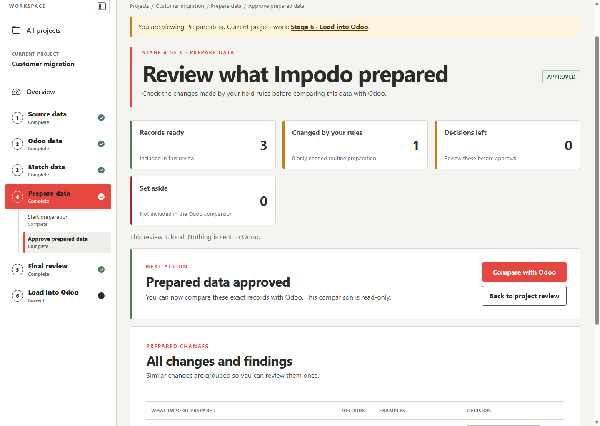
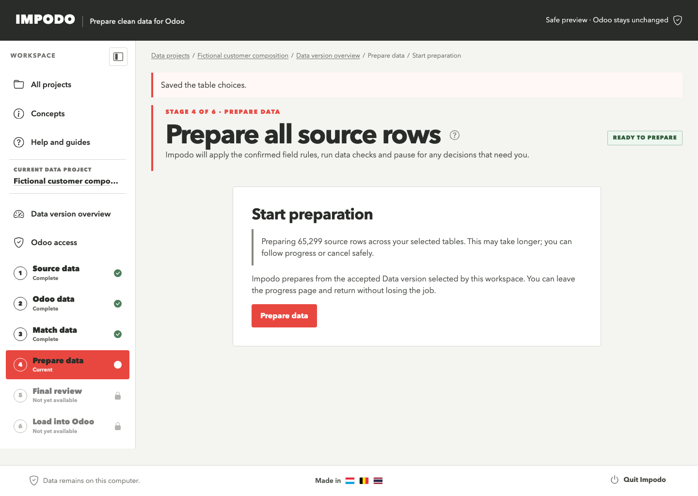

# Prepare data

## Goal

Apply the confirmed mapping to every frozen row in the current data version,
check data quality, and resolve findings before comparing anything with Odoo.

## Before you start

The exact mapping version must be checked and confirmed. Do not start while a
source, schema, key, or transformation decision is still changing.

## Steps in Impodo

1. Open **Prepare data**.
2. Select **Prepare data** once and follow the progress page.
3. Review row totals, warnings, quarantined rows, and preparation failures.
4. Open **Resolve possible duplicates** when Impodo finds records that may
   describe the same business entity.
5. Merge or keep candidates separate using business evidence.
6. Review prepared-value groups and accept or reject proposed normalization
   decisions when they are present.
7. Approve the resolved prepared data only when no required decision remains.
8. Select **Compare with Odoo** when you are ready to check the approved data
   against the target. This starts the same read-only comparison used by
   **Final review**; moving between the two stages does not start a second
   comparison.
9. If you want to reuse the revised rules, select **Review and save Recipe**.
   This opens the data project; it does not save by itself. Review readiness,
   then select **Save as a new Recipe** or **Save a new Recipe version**.

## How Recipes reuse this work

A Recipe reuses confirmed preparation rules, not a prepared snapshot. Every
data version must run preparation again from its own accepted source and current
mapping confirmation. An Integrated Test creates a separate Recipe work area and mapping draft
for each Recipe in an integrated Test plan; earlier prepared rows are not
copied into it.

Matches confirmed with **Match values** are also Recipe rules when their source
field belongs to a combined table. For example, a saved match from `Wholesale`
to an existing Odoo classification is applied to each matching row in the new
delivery. Impodo rebuilds the combined table and checks its current choices.
A new choice without a saved match needs your review before the Recipe can
continue.

An explicit **Leave blank (no linked record)** decision is retained in the
same way. Preparation leaves that relationship empty on the matching rows;
you do not need to choose the decision again for a compatible delivery.

This fresh run is mandatory even when the replacement files look identical.
Preparation, quality findings, duplicate decisions, normalization approval,
and content hashes from an earlier data version are historical evidence and
cannot qualify the current one.

## What to check

- Source, prepared, quarantined, and rejected totals reconcile.
- Every source row is accounted for.
- Relationship values resolve to exactly one intended record.
- Duplicate decisions preserve distinct business entities.
- Prepared values still express the source meaning after cleanup.
- Blocking findings are resolved rather than hidden.

When a child record uses its parent as part of its business identity, Impodo
keeps that complete record group together. For example, if a BoM component
does not have a matching product, Impodo sets aside that BoM, its other
component lines, and the missing component line. Other BoMs can still proceed
to review. The source files and Odoo remain unchanged.

When you open **Set aside**, **Migration issues** groups the causes across the
complete prepared result. The counts do not change when you move between
pages. Root findings appear before inherited dependencies. An **Inherited
dependency** means that Impodo set the row aside because a linked parent or
another member of its identity group was already unsafe.

Each issue card shows the affected record type, friendly fields, complete-run
record count, correction owner, and one **Match data** action. For a direct
cause, the card also separates the parents, children, and siblings that Impodo
set aside through linked-record dependencies. When current saved evidence
identifies the exact Odoo field, relationship, Odoo match, or data check, that
action opens the corresponding decision. Opening it does not change accepted
source data or saved rules. Save a deliberate correction and then prepare the
complete data again.

Select **Review affected records** to inspect the complete set behind one
card. The paged list labels a record as a **Direct finding**, **Affected
parent**, **Affected child**, or **Affected sibling**. It shows only saved
prepared-data evidence and does not rerun preparation, read Odoo, or change a
source or rule. Return to the card's correction action, make the deliberate
change, and prepare the complete data again.

For a mapped number, a card can say **Prepared value exceeds Odoo precision**.
This means an exact prepared value needs more decimal places or total digits
than the captured Odoo field allows. The card shows the captured capacity and
aggregate impact, not the value itself. It is an early advisory: the row can
still proceed because Final review later checks only fields that would actually
be written. Use **Open … rule** to add an explicit conversion or rounding rule,
or **Review Odoo precision** when the Odoo owner should change the field. Impodo
never rounds silently; after either deliberate correction, prepare all data
again.

Each record still shows every saved finding, the friendly field name, the
source row, the responsible role, and the next correction route. A linked-row
finding states whether the parent is missing, ambiguous, or already set aside.
Use the source row and field name to correct the source or field match, then
prepare the data again. The row table remains paged so you can inspect the
saved evidence without loading the complete result into the browser.

## What Complete means

Impodo has a frozen, fully accounted prepared result for the current source,
schema, and mapping evidence. **Final review** becomes available for the
current file data version. Prepare data offers **Compare with Odoo** so that
target-only relationship and numeric-precision problems can be discovered
immediately after approval. Final review opens that same saved comparison.

This preparation update preserves complete saved results. You can review a
current saved preparation in the same workspace without creating a replacement
project or selecting your source again. Changed source data, schema, or field
matches still require a fresh preparation.

## What changes and what does not

Preparation saves protected prepared-data evidence. Preparing and approving
the data does not call Odoo, change the accepted source, modify the Recipe
version, or copy prepared rows between data versions. **Compare with Odoo** is
a separate explicit read-only action owned by Final review. Publishing the
reusable rules is also a separate explicit action. Merge and normalization
decisions affect the prepared result, not the original evidence.

## Needs attention

Investigate blocked rows, unresolved relationships, unexpected quarantine,
count differences, or a stopped background job. A cancelled or failed attempt
may be retried only after its recorded outcome is understood.

**Preparation stopped** means the attempt has ended unsuccessfully. The
**Stopped at** percentage shows the last step reached; waiting will not resume it. After the
cause has been corrected, return to **Prepare data** in the same workspace
and start a fresh attempt. You can keep your accepted source data and saved
field matches.

Direct parent-and-child tables can now use the preparation route for up to
50,000 source rows in the selection. This includes document lines, hierarchies,
and BoM components whose matching rules use an incoming parent as part of
their identity. The same limit applies when the identity uses an existing Odoo
record or checks Odoo before an incoming parent. Impodo still checks the
complete group together. The route comes from the saved relationship rules,
so it applies to standard and custom Odoo models without a BoM-specific setup.

Several combined tables can prepare together in the same workspace. For example,
you can prepare a Contacts table and a second combined Addresses table from the
same accepted delivery. Impodo checks the relationships between the outputs and
keeps each source row accounted for once, even when both tables use it.

A combined table can also prepare beside a reusable list extracted from one
source column. For example, customers and their generated Company chain list
can prepare together. If that optional link may be empty, choose **Leave the
related field blank** on the field in **Match data**, then check and confirm
the field matches again. Preparation keeps those customers eligible without
creating an empty entry in the related list.

For reviewed exact combinations, a large source count is a notice rather than
a preparation cutoff. The complete route has been checked with 65,299 and
100,000 source rows, including two combined outputs, Many2one matches, intentional
blanks, and reuse of the saved Recipe with fresh files. Above 50,000 source rows,
**Start preparation** explains that the job may take longer. Select **Prepare
data** as usual; no extra confirmation is required. Invalid source evidence,
ambiguous keys, required values, and exhausted processing resources still need
correction.

One generated related table made from the distinct values in a single source
field can also use the 50,000-source-row route when it contains no more than
5,000 generated records. For example, a small Work Centres table generated
from an operation field qualifies. Additional business checks, reference data,
hierarchies, table splits, or other rules that build tables retain the lower
materialized limit.

Other preparation routes keep their separate limits. If one of those routes
exceeds its supported size, Impodo stops before preparing the rows and reports
the limiting stage. Restarting the same setup will not change that limit. Your
saved field matches remain available.

For a Recipe run, return to **Review and load** after preparation stops or you
reopen Impodo. If the Recipe already has a complete, current saved result,
Impodo offers its review without preparing the rows again. See
[returning to a Recipe run](../guides/integrated-test-runs.md#needs-attention).

If Impodo reports that it was updated while preparation was starting, restart
Impodo. The stopped attempt did not open the workspace or contact Odoo. Do not
repeat the same attempt from the old browser session.
Save edits in your open tabs before restarting, then reopen the same project
and workspace. You do not need to create a new project to use a preparation fix.

## What makes this work stale

Any change to source evidence, Odoo schema, business keys, mapping version,
parameters, controls, or required resolution invalidates the prepared result.
Run preparation again instead of modifying stored artifacts.

## Next stage

Continue to [Final review](05-final-review.md).

## Related documentation

- [Developer implementation: Prepare data](../../developer/workflow/04-prepare-data.md)
