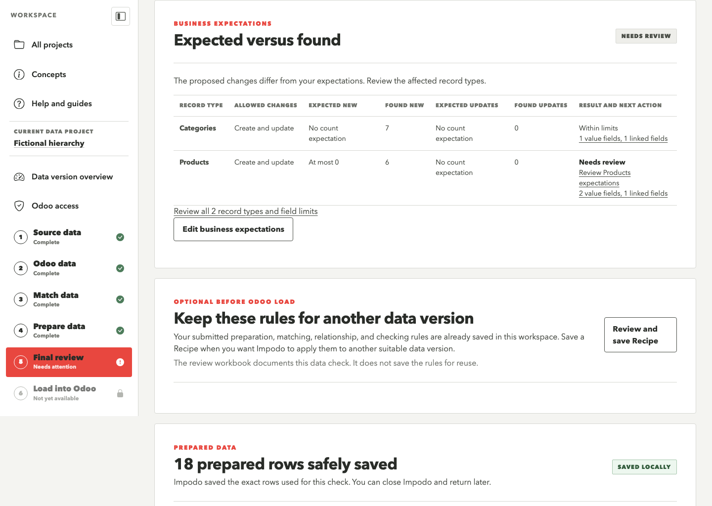
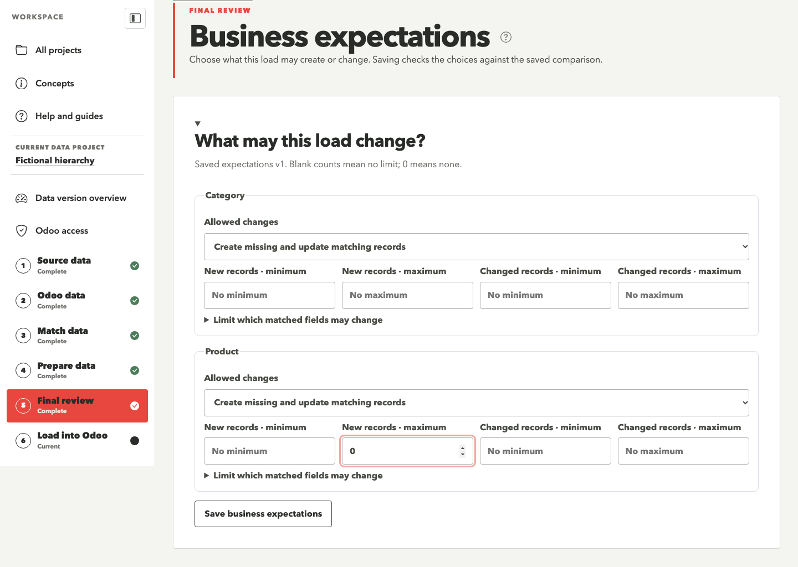
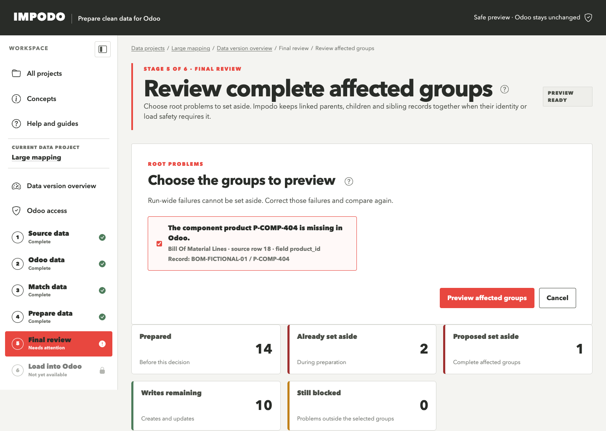
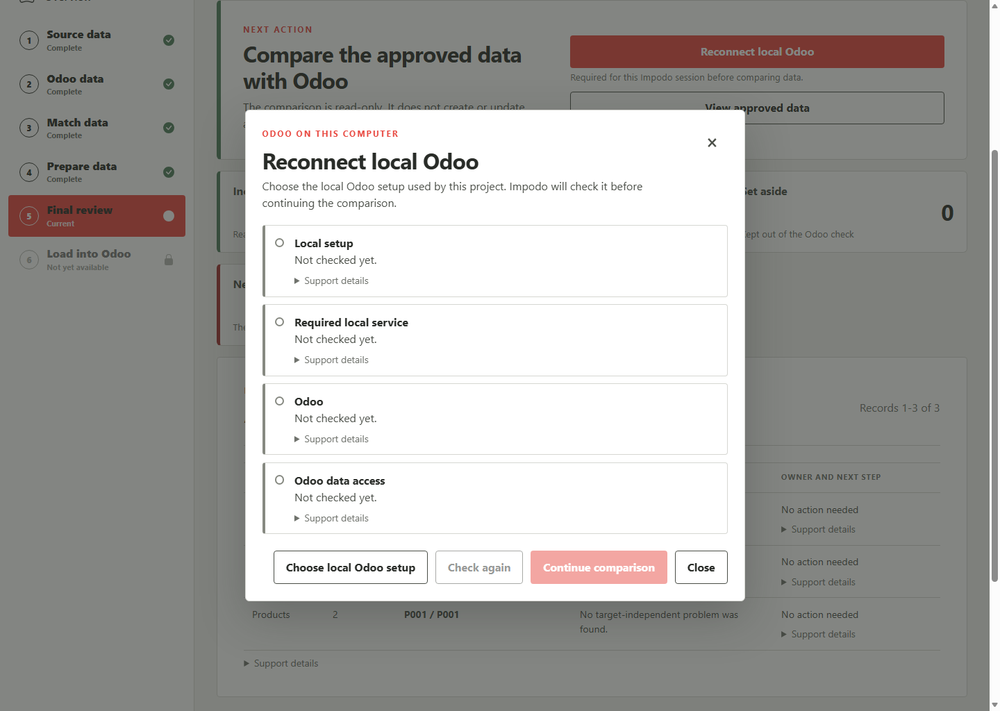

# Final review

## Goal

Compare every eligible prepared row in the current data version with
fresh Odoo evidence and decide whether the proposed outcome is safe to take to
the load stage.

Rows excluded by your confirmed **Rows to use** rule stay outside this
comparison and the later load. Their source decisions remain available for
review. Their absence never asks Odoo to delete an existing record.

In the prepared-data **Set aside** list, **Excluded by filters** means that a
row did not meet your **Rows to use** rule. Select **Review Rows to use** to
open that table’s rule. **Set aside for a data issue** shows the saved finding
and the owner responsible for correcting it.

When a combined table has no matching source row, Impodo names the missing
table and the identifier left empty. For example, if 150 suppliers have no
matching account row, those 150 suppliers stay set aside. The empty identifiers
appear as one missing-match finding. You can continue comparing the included
records when the other required checks are complete.

The record list shows available prepared values with field labels, including
the name, even when the identifier is missing. Open **More prepared values**
to inspect the remaining values. Select **Review combined tables** to correct
the source-table combination, then prepare and approve the data again.

## Before you start

Prepared data must be complete for the current source, schema, and mapping.
Use a reachable supported Odoo 19 or final Odoo 20 target with the approved
read access.

For a prepared file-source load, Impodo also checks the proposed changes
against the saved business expectations. A safe individual record can still
conflict with the intended purpose of the load. Setting aside groups changes
the totals, so the remaining records must still satisfy any minimum or maximum
counts before loading.

### Review your business expectations

Use **Expected versus found** to compare the allowed changes and expected
counts with the proposed result for each record type. For example, **At most
0** new Products with **6** found means the proposed load needs review. A
blank count appears as **No count expectation**; it never means zero.

Select **Review Products expectations** to return to that record type, or
**Edit business expectations** to review all choices. In **What may this load
change?**, choose the allowed changes and optional minimum and maximum counts.
Open **Limit which matched fields may change** only when the load needs a
narrower list of value or linked-field changes. Saving reassesses the saved
comparison without reading Odoo again. Correct the source or matching rules
instead when the proposed changes are wrong.

Use the field-count links to inspect the expected and proposed field effects.
The detail page shows one record type and up to 50 effects at a time. If
another tab saves newer expectations, reload the saved choices before editing
again. Your older form cannot overwrite them silently.

## Steps in Impodo

Final review has three sidebar pages. Each page shows one part of the review.
You can return to an earlier page without repeating a saved decision.

| Page | What you do |
| --- | --- |
| **Prepared data** | Inspect included records and preparation findings. **View approved data** opens the existing Stage 4 review. |
| **Compare with Odoo** | Check the destination, start the comparison, or return to its saved result. Comparison progress and recovery belong to this page. |
| **Review results** | Inspect **Needs attention**, **Proposed changes**, or **Records outside this load**, then follow the available next action. |

The current sidebar page identifies your location. Its status comes from the
saved checks. Opening a page does not complete its checks. Preparation approval
stays in Stage 4, and final load confirmation stays in Stage 6.

1. Open **Final review**. Impodo opens the relevant page for the saved state.
2. On **Compare with Odoo**, select **Compare with Odoo**.
3. Follow the comparison progress page while Impodo verifies the setup, reads
   Odoo, compares records, builds the review, and saves it. You may leave and
   reopen the page while the current Impodo session remains open.
4. Review totals for **New in Odoo**, **Different from Odoo**, **Already
   matches**, **Needs attention**, and **Set aside**.
5. Inspect field-level differences and relationship resolutions.
6. On a **Must fix** card, select **Preview rows to set aside** to see what
   would stay out of this load because of that finding. If other findings
   still block the load, you can select them on the preview and click
   **Update preview**. You can also start with **Preview all problem groups**
   or use **Choose affected groups** to review individual records. Each
   preview includes linked records that must stay together.
7. Review the omitted records, **Writes remaining**, and **Still blocked**.
   If safe writes remain and nothing is still blocked, select **Set aside
   affected groups for this load** (or **Set aside all problem groups** from
   the bulk preview). Impodo returns you to Final review with the reduced
   load ready to review. Correct any problem that affects the whole comparison,
   then compare again.
8. Select **Download rows needing attention** to share the complete correction
   worklist in Excel. When the proposed load is ready, use the separate review
   workbook to inspect or retain the full proposed load.

A clean comparison can open Stage 6 **Check changes** directly. The page
identifies the completed Final review and links to its saved comparison.
Recipe Test runs retain their existing automatic completion when no changes
are needed.

**Records outside this load** separates records omitted during preparation
from records omitted by an accepted Final review decision. Open the relevant
list to inspect its rows. The preparation list explains whether a row was
excluded by filters or set aside for a data issue. These are different reasons
for keeping a record out of the load.

After a set-aside decision, **Current load after your set-aside decision**
describes the remaining load. **Original comparison findings** retains the
earlier findings; accepting omissions does not correct the underlying data.

When a correction opens an earlier stage, **Return to Final review** returns
to the originating review page and filter when browser storage is available.
A changed preparation or comparison takes priority over the remembered scroll
position. Follow the current preparation or comparison action before relying
on the new result.

**Downloads** and Recipe saving remain supporting actions. A workbook that has
not been created does not itself make the migration incomplete.

### Download a correction worklist

Select **Download rows needing attention** after preparing the data, including
when unresolved findings prevent you from continuing. The export includes all
saved findings across every table and page. The browser's current row filter
does not restrict it. Records intentionally omitted by **Rows to use** are
counted separately.

The counts beside the download show distinct affected records and findings.
Open **What this correction worklist includes** to see the problems and next
actions that also appear in the workbook. If the counts cannot be checked,
select **Retry export counts** or reopen Final review.

Start with **Overview** for the distinct affected-record count and the checks
completed. Before comparison, the report says **Odoo comparison not completed**.
After comparison, it also includes the current Odoo findings and any saved
load-expectation problem.

In **Needs attention**, each line identifies a record and one problem. It names
the source location, affected columns, available original and prepared values,
why the record needs attention, a suggested action, and where to correct it.
Whole-table and whole-load findings state their scope instead of blaming an
individual row. A record held back by a linked record points to that cause.

Open the **Data** sheets to see the affected records and highlighted columns.
For duplicates, review the complete matching columns and all peers in
**Duplicate groups**. Larger peer lists link to that sheet. Repeating one
reference is not by itself an error when another identifying column, parent,
or company distinguishes the records.

**Not retained** means the saved evidence has no original value available.
**(empty)** identifies an actual empty value. **Restricted** identifies a
protected value that remains inside Impodo, including Odoo-source values.
Identifiers retain leading zeros, and source text is displayed as literal text
in Excel. Excel cannot display an individual cell above its text limit; Impodo
reports that limitation instead of silently shortening a finding.

Correct the source, the named Impodo choice, or Odoo as indicated. Then prepare
and compare again. Editing this workbook does not change Impodo. If the saved
results change during export, reopen Final review and download the current
report.

Before comparison, the prepared-data section can show records that Impodo set
aside. Its cause summary distinguishes a problem on the record itself from a
problem inherited from a linked record. The summary counts affected records
across the complete prepared result, even when the row table is filtered or
paged. Direct cause cards also separate parents, children, and siblings set
aside through dependency propagation. Open each row to review all findings and
use its source row, field name, owner, and correction route to fix the cause
upstream.

Use **Review affected records** on a cause card when you need the complete
paged list behind its totals. The page distinguishes the direct finding from
parents, children, and siblings set aside through the saved dependency
closure. Opening it makes no Odoo request and changes no saved decision.

### Understand comparison blockers

Use the question mark beside the blocked-record action to open this
explanation. Follow the correction action in Impodo, then repeat the comparison.

After comparison, **Migration issues** also summarizes blockers that Final
review found only against current Odoo evidence. These cards remain complete
when the checked-row table is filtered or paged. A card states the cause,
owner, affected record type and count, saved work that remains unchanged, and
the check to repeat. Select **Review affected record type** to open only the
saved decisions with that exact cause. Opening the list does not compare again,
change source data or field matches, or write to Odoo.

A prepared-value precision advisory does not itself stop comparison. It shows
the Odoo field capacity captured during matching and opens either the exact
number rule or **Odoo data**. Final review then applies the authoritative check
only to values that would actually be created or updated. An unchanged value is
not treated as a write blocker, and Impodo never rounds a proposed write
silently.

The progress page reports elapsed time during work that has no honest row
percentage. Delayed progress updates do not start another comparison. Selecting
**Compare with Odoo** again from the same page while the same workspace already
has that active comparison returns to the same attempt. If Impodo restarts,
reopening the progress page shows either the verified saved result or an
interrupted attempt that you can safely retry.

### Set aside complete affected groups

The question mark beside **Choose the groups to preview** opens this
explanation before you decide which complete groups to keep out of the load.

The affected-group preview is calculated from the saved comparison. It shows
the prepared count, records already set aside during preparation, records that
the new decision would omit, writes remaining, and problems still blocking the
remainder. Accepting the preview makes no Odoo request and applies only to the
current comparison. It does not edit the source, matching rules, or Odoo. If
the comparison or preview has changed, Impodo rejects the old confirmation and
asks you to review it again.

If Impodo closes before the comparison is saved, the previously current review
remains unchanged. The old progress page identifies the attempt as interrupted;
reopen **Final review** and compare again. If the complete report was saved just
before shutdown, Impodo verifies it and recovers that success instead. A
completed report is published atomically, so an interrupted attempt cannot make
a partial review current.

If the comparison inputs change while an attempt is queued or running, Impodo
rejects that attempt and keeps the previous saved review. Reopen **Final
review** and compare again using the current inputs.

After a ready comparison, **Check changes** opens the saved bounded summary of
datasets, write totals, load order, and blockers. The final confirmation still
checks the exact complete saved load before anything can change in Odoo. A
review created by an older Impodo version may not contain the bounded summary;
in that case Impodo asks you to **Compare with Odoo again** instead of rebuilding
the review from possibly changed data.

The workbook opens with **Review overview**, which tells you what will happen,
whether anything needs attention, and what you should do next. Use **Needs
attention** before reviewing **Records to load**. For a file source, **Records
to load** shows the prepared values that Impodo will use. **Changes to Odoo**
shows the new value first and retains the current Odoo value as supporting
evidence. **Excluded by filters** lists the rows left out by **Rows to use**
and the rule that excluded them. **Deferred issues** lists rows set aside
because of data problems, with their source rows, reasons, and the stage that
set them aside. Final review entries also identify the affected group and
whether the reason was direct or inherited. **Review overview** links to each
sheet and shows its row count.

The workbook uses status words as well as colours. A neutral blank is not a
problem by itself; **Cannot proceed** identifies a record that Impodo will hold
back. Correct source data or rules in Impodo, then prepare and compare again.
Editing a workbook cell does not change the saved data or proposed load.

The first tab, **Review overview**, includes a **Stage 3 transformation summary**.
It shows each saved field match with the source column heading, the Odoo
field's label and technical name, and numbered transformation steps. The steps
also use source headings, so a filter can read “Include a row when Active is
exactly Oui and Approved is exactly Oui.”
Fixed values show the actual value and the rows-to-use condition. Value matches
show the source and replacement values. Conditional choices show their order,
conditions, and otherwise value. Text changes list the exact search text or
pattern, replacement, and whether the operation replaces a prefix, suffix,
first match, or every match. The steps keep their saved execution order.

**Affected records** counts prepared records with a saved change for the whole
field, including records set aside from the load. It does not claim a separate
count for every step. A zero means no field change was recorded. A fixed value
has no source column. If exact saved settings are unavailable, the summary says
so. Restricted rule parameters remain hidden.

**Needs attention** is the workbook's action queue. Impodo sorts red **Must
fix** items before amber **Review** items. Each row identifies the source
dataset, record, field, final prepared value, reason, recommended action, and
source row. Use the header filters when you need to focus on one dataset,
field, or priority. Fix every red item in Impodo before loading; review each
amber item and decide whether its upstream field match or source data must
change.

The action queue does not list every safe transformation. **Changed by
Impodo** and **Added by Impodo** remain informational unless the comparison
also records a warning or blocker. This keeps the worklist focused on decisions
that need a data manager.

Open **Fields set aside** from **Review overview** to see saved field
omissions and their reasons. Red rows identify source values that need
correction. Amber rows identify matches to review. Blue rows identify saved
rules and choices, such as a source column used for validation only. Filter by
reason, dataset, or source field to find the entries you need.

The counts separate identified source cells from whole columns. If a finding
covers several source columns or lacks a precise source coordinate, Impodo
lists it as a field finding. Some saved evidence has a reason without the
original value. The workbook labels that value **Unavailable**. **Deferred
issues** explains why whole records were set aside.

In **Records to load**, each prepared field keeps only the final value in the
visible cell. The **Prepared value feedback** column identifies the affected
field and uses these statuses:

- **Changed by Impodo** means that a confirmed preparation rule transformed
  the source value.
- **Added by Impodo** means that a confirmed preparation rule supplied the
  value.
- **Review recommended** means that the field has a warning to review in
  Impodo.
- **Needs attention** means that the field has a problem which blocks safe
  progress.
- **Empty but allowed** means that the current comparison found no blocker for
  the blank. Impodo does not treat every blank as an error.
- **As provided** means that Impodo retained the prepared value without a
  recorded change.

A changed or added cell contains an Excel note with the original display value
and the confirmed preparation rule. Open the note when you need supporting
detail. Correct the source value or rule in Impodo and recreate the workbook;
changing the visible cell or its note does not change the migration.

When the source is Odoo, protected business values remain inside Impodo and do
not enter the portable workbook.

For local Odoo, **Reconnect local Odoo** may appear after Impodo restarts.
Choose the matching setup, then select **Continue comparison** when ready.

### If Impodo cannot compare

The progress page shows **Comparison stopped** and hides the progress bar.
If the Odoo checks stopped before saving, it states **No new comparison was
saved**. If a later step fails after a comparison was saved, the page confirms
that saved result. When Impodo cannot determine whether saving finished, it
says it could not confirm the result. Follow the recovery action
shown below the message. **View previous review** appears only when an earlier
review can still be displayed in Final
review. The support code and job identifier are under **Support details**.

Final review shows the action that owns the problem:

- **Enter the Odoo read key** or **Replace the Odoo read key** appears only
  when the read credential is missing, rejected, or lacks the required read
  access. Enter the key in the protected form and retry immediately.
- **Review Odoo connection**, **Capture Odoo data**, or **Review Odoo details**
  returns you to the Odoo stage when the target details or captured evidence
  needs attention.
- **Review field matches** and **Prepare data again** return you to the stage
  whose saved evidence is no longer current.
- **Try comparison again** appears for a temporary connection failure or an
  incomplete read-only response. It does not ask for a new key.
- An internal storage or unexpected failure shows safe **Support details** and
  does not claim that the Odoo credential is wrong.

Every recovery panel confirms that nothing was changed in Odoo and that your
saved work is unchanged.

## How saving a Recipe relates to this work

Comparison evidence is never part of a Recipe. A Recipe version can preserve
the reusable transformation rules authored in this workspace, but this
data version keeps its source, preparation, target comparison,
approval, and load evidence.

Applying one or several saved Recipe versions to replacement rollout data
still requires a new data version and fresh Odoo evidence.

## What to check

- The target fingerprint identifies the intended Odoo database.
- Create and update totals match the migration purpose.
- Unchanged rows require no write.
- Every changed field is expected and approved.
- No relationship points to an unresolved or ambiguous record.
- Every intended numeric write fits the captured Odoo field precision exactly;
  Impodo does not round a value or choose a rounding method automatically.
- A rerun against refreshed Odoo evidence gives an explainable result.

For an update-only reload of existing records, any nonzero **Create** count is
a hard stop until the identity or target evidence is corrected.

## What Complete means

The current report is **Ready** with no ambiguous or blocked rows, or **Ready
with records set aside** after a reviewed complete-group decision. It remains
bound to the exact prepared and target evidence. A reviewed set-aside scope
requires safe writes to remain. When an ordinary comparison finds no changes,
the existing Stage 6 **Complete without loading** path remains available if
the saved expectations permit it. Recipe Test runs can complete their existing
no-change verification automatically.

## What changes and what does not

Comparison reads Odoo and stores review evidence for this data version. It
does not write to Odoo, save a Recipe, or authorize another run.
Downloading a workbook or review result does not authorize execution.

## Needs attention

Stop for an unexpected create count, duplicate match, blocked relationship,
wrong target fingerprint, or Odoo read failure. Follow the one recovery action
shown on the page. Use **Support details** for the stable failure code; do not
replace a key unless the page specifically asks for one.

## What makes this work stale

Source, schema, business-key, mapping, reusable-rule, parameter, control,
prepared-data, target-evidence, or dependency-order changes require a fresh
comparison. Never load from an older data version's report.

## Next stage

Continue to [Load into Odoo](06-load-into-odoo.md) only for the explicitly
approved target and the exact current review.

## Related documentation

- [Developer implementation: Final review](../../developer/workflow/05-final-review.md)
