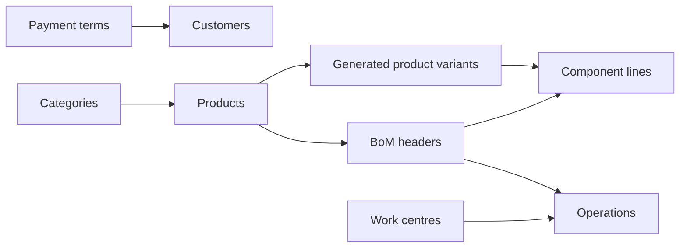

# Shared Morrow Assembly practice

Use one fictional business world to practise Impodo and to reproduce migration
issues. People and coding agents use the same source bytes, initial target
intent and independent business answers. Each component owns its files and
qualification receipts.

| Component | Source files | Exercises and starting point |
| --- | --- | --- |
| [Customers](v1/README.md) | 10 CSVs, 124 physical rows across two deliveries | Combine account, party and address exports; assign scoped payment terms; review a new term used by an existing and a new customer. |
| [Manufacturing](manufacturing/v1/README.md) | 12 CSVs, 236 physical rows across two deliveries | Preserve category paths; combine product exports; finalize product status; load separate BoM headers, component lines and operations. |

Select a component and follow its seed stages. Each automated exercise needs
the declared disposable target state; completing one component does not
silently supply the other's setup. Each load selects one operation company.
Products and categories are shared, while the manufacturing BoMs and work
centres have explicit company ownership.

Use these component packs for shared learner exercises and application
regressions. The small files in `examples/` serve profile examples and golden
comparisons. The files in `fixtures/` supply compatibility snapshots and
contract inputs. Other `scenarios/` directories own their executable canaries,
workbook round trips and scale cases. Their active consumers determine which
inputs they retain.

## Practise with the same data

Start with the component README, its source files, `target-seed-projection.json`
and `expected-business-results.json`. Keep business references as text and
review which export owns each repeated field label. The manifests pin source
and answer hashes. A second delivery is an explicit input for Recipe reuse;
its missing unrelated models do not request target deletion.

For customer practice, `python -m scripts.prepare_practice_target --help`
describes the seed-only command. It creates only a fresh disposable baseline,
starts no workflow, service or browser, and retains its private setup ledger.
Use your existing Impodo session with that prepared target.

For manufacturing, use
`python -m scripts.prepare_practice_manufacturing_target --help`. Its
`--stage initial` prepares only the declared starting references. Load the
categories through Impodo, then run `--stage existing-products` with the same
private `--seed-directory`. That step validates the saved target binding and
all twelve category paths before creating the eight declared existing products.
Both stages require the allocated descriptor and explicit `--allow-write`.
They load no migration and retain their private evidence.

Follow the manufacturing journey in this order:

1. Prepare the initial seed, preserving native Services as an unowned reference.
2. Load the supplied categories.
3. Prepare the eight existing products using the saved seed ledger.
4. Load the NORTH and SOUTH product partitions with the normal active default.
5. Run NORTH and SOUTH product-status phases to apply the final inactive values.
6. Load NORTH and SOUTH BoM headers, lines and operations.

The automated runner follows the same seven application phases around the two
setup steps. The independent seed projection and business oracle own every
starting value, intermediate active state and final answer.



## Run the application exercises

Install the checkout's `test` extra and run from the repository root using its
uv runner. Discover the exact arguments with:

```sh
python -m scripts.qualify_practice_customers --help
python -m scripts.qualify_practice_manufacturing --help
```

For example, run an isolated controlled manufacturing journey in a new output
directory:

```sh
UV_CACHE_DIR=.uv-cache .tools/uv/uv run --frozen --extra test --group quality python -m scripts.qualify_practice_manufacturing \
  --controlled --expected-major 20 --mode LOCAL --entrypoint authoring \
  --output-directory /tmp/morrow-manufacturing-20-local-authoring
```

Both runners use normal source acceptance, saved combinations, mapping,
preparation, approval, comparison, durable reopening, journalled writes,
reconciliation and independent read-back. Recipe runs publish reviewed rules
and apply them to a distinct delivery before the first target load.
Controlled runs replace the Odoo boundary. Live runs require an allocated
fresh target, its private descriptor and explicit `--allow-write` before
credential access. The runners retain the target and private evidence.

## Interpret the evidence

Read the run's output directory for its status, exact source and answer
hashes, observed Odoo version, access mode, entrypoint and completed checks.
Record controlled application checks, live Odoo results, visual browser checks
and supported-host tests with their own evidence.

The maintainer deferred live HTTPS qualification for Odoo 19 Authoring and
Recipe, and Odoo 20 Authoring. A later run needs a fresh allocation and its
own evidence. Qualification of a practice exercise does not close the separate
hosted, Linux, Windows or release guardrails.

The manufacturing main case consumes separate supplied headers, component
rows and operation rows. It does not qualify header derivation through a
related split. CSV timestamp text does not qualify native Excel cells. Small
contract, compatibility, serialization, workbook, recovery and scale fixtures
retain their own consumers and evidence.

On a failure, retain the journal and private application evidence. Automatic
target cleanup, blind retry and interrupted-write recovery are outside these
practice commands. Public results contain reviewed counts and hashes; keep
operational descriptors, credentials, ledgers and raw evidence private.
